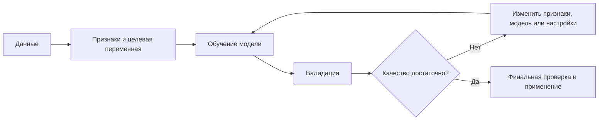
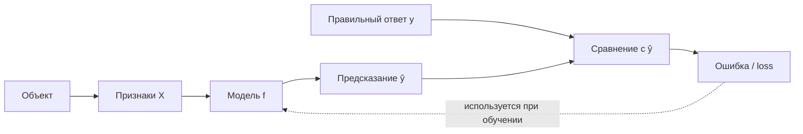
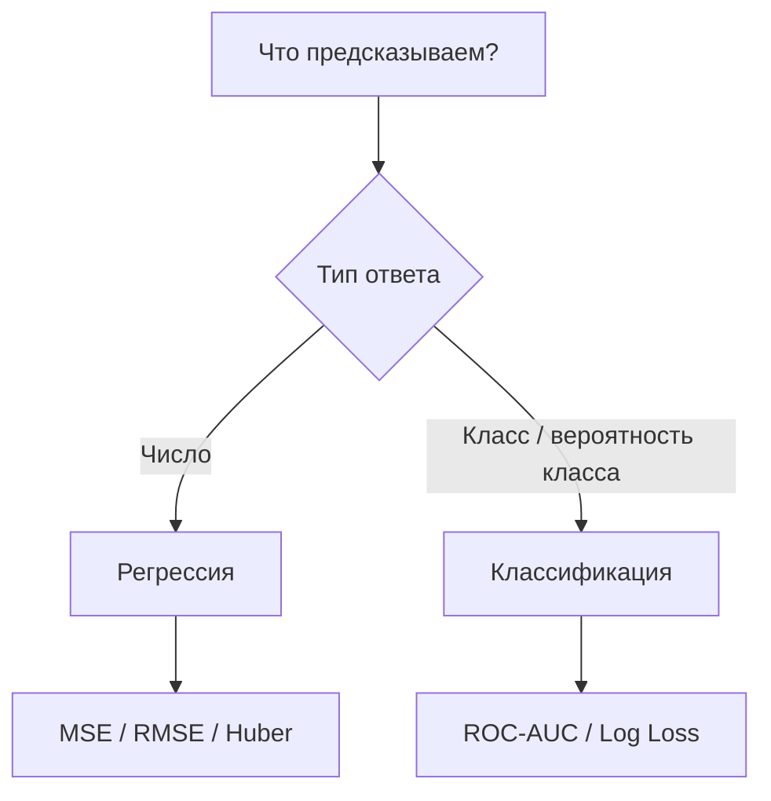
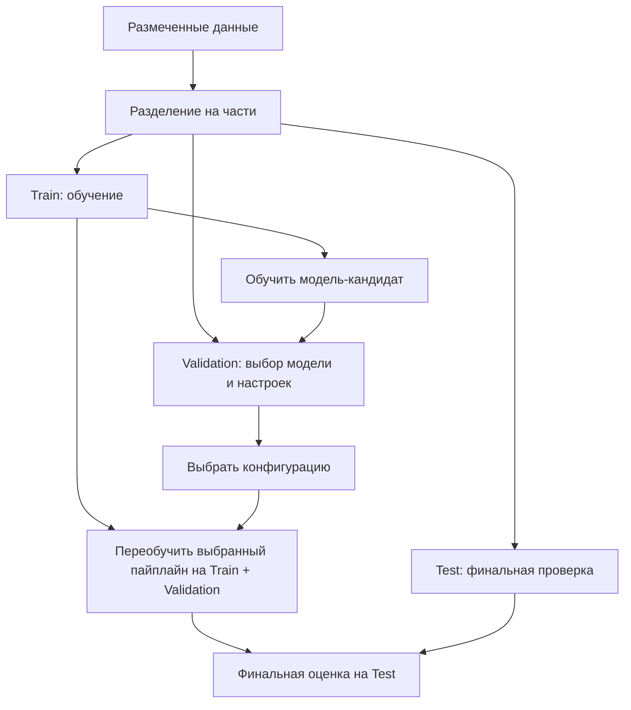
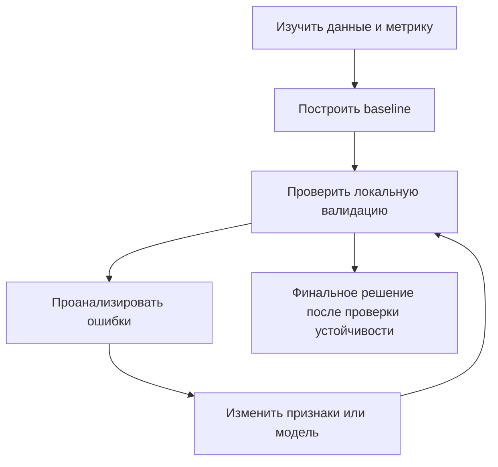
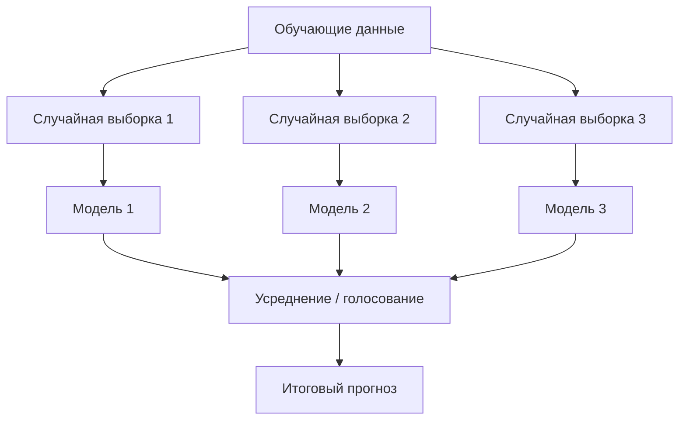
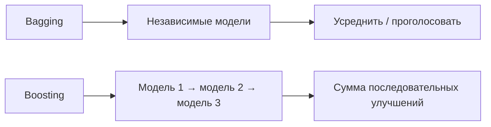
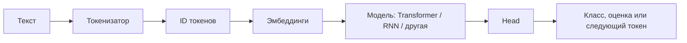
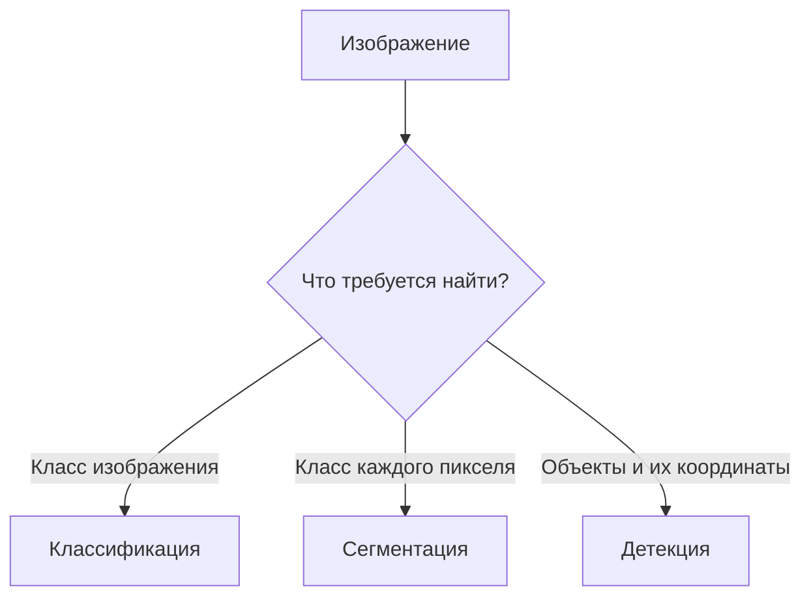

# Лекция 1. Обзор соревновательного машинного обучения: табличные данные, NLP и Computer Vision

**Курс:** «Практикум по соревновательному машинному обучению от МТС»  
**Тип занятия:** обзорная лекция  
**Дата:** 19 сентября 2026  
**Основная идея:** сначала освоить общую механику машинного обучения на табличных данных, а затем перенести эти знания на задачи обработки текста (NLP) и изображений (Computer Vision, CV).

> Это обзорная лекция: её цель — дать карту основных задач, метрик, алгоритмов и направлений курса. В следующих занятиях общие идеи будут разобраны подробнее, с математикой и практической реализацией.

## Оглавление

- [Карта курса](#1-карта-курса)
- [Базовая схема задачи машинного обучения](#2-базовая-схема-задачи-машинного-обучения)
- [Метрики машинного обучения](#3-метрики-машинного-обучения)
- [Решение соревнования и валидация](#4-как-обычно-решают-задачу-в-соревновании)
- [Ансамбли и Deep Learning](#5-ансамбли-bagging-и-boosting)
- [Обработка естественного языка (NLP)](#6-обработка-естественного-языка-nlp)
- [Специальные токены и формы тензоров](#7-специальные-токены-и-формы-тензоров)
- [Computer Vision](#8-computer-vision-cv)
- [Перенос идей между доменами](#9-перенос-идей-из-nlp-и-cv-в-другие-домены)
- [Темы курса и организационные детали](#10-программа-и-ожидаемые-темы-курса)
- [Главные выводы](#11-главные-выводы)
- [Вопросы для самопроверки](#12-вопросы-для-самопроверки)

## 1. Карта курса

Курс рассчитан примерно на год. В течение него планируется рассмотреть:

- **классы задач:** табличное машинное обучение, обработку естественного языка и компьютерное зрение;
- **данные и их представление:** признаки, таблицы, последовательности токенов, изображения и тензоры;
- **модели и алгоритмы:** от простых базовых решений до ансамблей и нейронных сетей;
- **теорию и практику:** сначала понять идею метода, затем реализовать или применить его в коде;
- **соревнования:** решать задачи, сравнивать подходы и учиться получать воспроизводимый результат.

Основные этапы курса:

1. **Осень 2026 года — табличные данные.** Базовые задачи, метрики, валидация, ансамбли. На следующем занятии ожидается градиентный бустинг.
2. **Далее — NLP (Natural Language Processing).** Представление текста, простые модели, эмбеддинги и нейросетевые архитектуры, затем методы обучения языковых моделей.
3. **Зима–весна 2027 года — Computer Vision.** Классификация изображений, сегментация и детекция объектов.

Последовательность и глубина тем могут уточняться по мере прохождения курса.

---

### Общая карта машинного обучения 🧭



Главная логика всего курса: понять задачу и данные, построить базовое решение, проверить его по подходящей метрике и только затем усложнять модель.

---

## 2. Базовая схема задачи машинного обучения

**Машинное обучение (Machine Learning, ML)** — область, в которой алгоритм находит закономерности в данных и использует их для предсказаний или принятия решений. Вместо того чтобы вручную прописывать все правила, мы задаём данные, целевую задачу и процедуру обучения.

### 2.1. Признаки, целевая переменная и модель



Смысл схемы: во время обучения модель сравнивает свои предсказания с известными ответами и подбирает параметры так, чтобы ошибка уменьшалась. После обучения правильный ответ для нового объекта обычно неизвестен, поэтому модель только выдаёт предсказание.

Типичный набор данных с учителем можно представить так:

- **объект (sample, observation)** — одна запись, для которой нужно сделать предсказание;
- **признаки (features, `X`)** — информация об объекте, доступная модели;
- **целевая переменная (target, `y`)** — правильный ответ, который модель должна научиться предсказывать;
- **модель** — функция, которая по признакам выдаёт предсказание: $\hat{y} = f(X)$;
- **обучение (training)** — подбор параметров модели по примерам;
- **предсказание (prediction, `ŷ`)** — ответ модели на новом объекте.

Например, в задаче оценки стоимости квартиры признаками могут быть площадь, район, этаж и число комнат, а целевой переменной — цена. В задаче банка признаками могут быть сведения о клиенте и его операциях, а целевой переменной — вероятность некоторого события, например невозврата кредита. Конкретная постановка зависит от задачи.

**Обучение с учителем (supervised learning)** означает, что в обучающих данных есть целевые ответы. Две базовые задачи этого курса — классификация и регрессия.

### 2.2. Бинарная классификация

**Бинарная классификация (binary classification)** — задача, в которой у объекта один из двух классов: например, `0` или `1`.

Примеры:

- транзакция подозрительная или обычная;
- клиент уйдёт или останется;
- на изображении есть нужный объект или нет;
- сообщение относится к нужной категории или нет.

Модель часто сначала выдаёт вероятность положительного класса $p = P(y=1\mid X)$. Чтобы получить окончательный класс, вероятность сравнивают с порогом, например `0.5`. Порог не обязательно равен `0.5`: его выбирают с учётом задачи и цены ошибок.

**Классификация не всегда бинарная.** Если классов больше двух, задача называется многоклассовой классификацией (multiclass classification). Например, распознавание одного из десяти видов животных.

### 2.3. Регрессия

**Регрессия (regression)** — задача предсказать числовую величину. Например:

- цену квартиры;
- цену товара;
- объём продаж магазина;
- спрос на товар в определённый день.

В отличие от классификации, ответом здесь обычно является число, а не метка класса.

### 2.4. Функция потерь и метрика — не одно и то же

| Понятие | На какой вопрос отвечает? | Для чего нужно? |
|---|---|---|
| **Функция потерь (loss)** | Насколько ошиблась модель по выбранному критерию? | Часто по ней алгоритм обучает модель |
| **Метрика (metric)** | Насколько хорошо модель решает задачу с точки зрения соревнования или пользователя? | Сравнивать решения и выбирать лучший результат |

Эти величины могут совпадать, но не обязаны. Поэтому до обучения проверь, какую метрику использует соревнование и какое направление считается улучшением.

- **Функция потерь (loss function)** оценивает ошибку предсказания и обычно используется при обучении: алгоритм старается подобрать параметры, чтобы уменьшить loss.
- **Метрика (metric)** оценивает качество модели с точки зрения задачи. По ней сравнивают решения, проводят эксперименты и нередко определяют место в соревновании.

Одна и та же величина может использоваться и как функция потерь, и как метрика, но это не обязательно. Например, ROC-AUC обычно используют для оценки качества ранжирования, а Log Loss может быть функцией оптимизации вероятностной модели и метрикой качества.

Важно выяснить, **какая метрика используется в конкретном соревновании** и в какую сторону она улучшается: одни метрики нужно минимизировать, другие — максимизировать.

---

## 3. Метрики машинного обучения

Основные метрики зависят от типа задачи: для регрессии часто используют MSE, RMSE и Huber loss, а для вероятностной классификации — ROC-AUC и Log Loss.

### 3.1. MSE — Mean Squared Error

**Среднеквадратичная ошибка (MSE)** — среднее квадратов разностей между правильными значениями и предсказаниями.

$$
\text{MSE} = \frac{1}{n}\sum_{i=1}^{n}(y_i-\hat y_i)^2
$$

Здесь $y_i$ — правильный ответ, $\hat{y}_i$ — предсказание, `n` — число объектов.

**Как понимать:** чем сильнее промах, тем больше его вклад, поскольку ошибка возводится в квадрат. Поэтому MSE сильно реагирует на большие ошибки и выбросы.

- Типичное применение: регрессия.
- Направление улучшения: **меньше — лучше**.
- Недостаток для интерпретации: единицы измерения становятся квадратом единиц целевой переменной. Если предсказываем цену в евро, MSE выражается в условных евро в квадрате.

### 3.2. RMSE — Root Mean Squared Error

**Корень из среднеквадратичной ошибки (RMSE)**:

$$
\text{RMSE} = \sqrt{\text{MSE}}
$$

RMSE сохраняет акцент на больших ошибках, как и MSE, но измеряется в тех же единицах, что и целевая переменная. Если модель предсказывает цену в евро, RMSE также измеряется в евро.

- Типичное применение: регрессия.
- Направление улучшения: **меньше — лучше**.

### 3.3. ROC-AUC

**ROC-AUC** — площадь под ROC-кривой. ROC-кривая показывает, как меняются доля истинно положительных ответов (*True Positive Rate*, TPR) и доля ложноположительных ответов (*False Positive Rate*, FPR) при изменении порога классификации:

$$
\mathrm{TPR}=\frac{TP}{TP+FN},\qquad
\mathrm{FPR}=\frac{FP}{FP+TN}.
$$

Здесь `TP` — верно найденные положительные объекты, `FN` — пропущенные положительные объекты, `FP` — отрицательные объекты, ошибочно признанные положительными, `TN` — верно распознанные отрицательные объекты.

Интуитивно ROC-AUC измеряет, насколько хорошо модель **ранжирует** положительные объекты выше отрицательных. При стандартной интерпретации значение около `1` означает хорошее разделение классов, около `0.5` — качество примерно на уровне случайного ранжирования, а меньше `0.5` может указывать на систематически обратное ранжирование.

- Типичное применение: бинарная классификация.
- Направление улучшения: **больше — лучше**.
- Важное отличие от accuracy: ROC-AUC оценивает ранжирование по разным порогам, а accuracy — долю верных классов при конкретном пороге.
- ROC-AUC не гарантирует, что выданные вероятности хорошо откалиброваны: для качества самих вероятностей нужны другие оценки, например Log Loss.
- **Accuracy (доля правильных ответов)** — доля объектов, класс которых модель определила верно при выбранном пороге. В отличие от ROC-AUC, accuracy зависит от конкретного порога.

### 3.4. Log Loss — логарифмическая потеря

**Log Loss** (для бинарной классификации также часто называют binary cross-entropy) оценивает качество предсказанных вероятностей. Для объекта с меткой $y\in\{0,1\}$ и предсказанной вероятностью положительного класса `p` потеря равна:

$$
\ell(y,p)=-\bigl(y\log p+(1-y)\log(1-p)\bigr)
$$

Для набора объектов значения усредняют.

Интуиция: если правильный класс — `1`, модель должна выдать высокую вероятность `p`; если модель уверенно выдаёт почти ноль, ошибка будет большой. Аналогично для класса `0`.

- Типичное применение: вероятностная классификация.
- Направление улучшения: **меньше — лучше**.
- Log Loss учитывает не только выбранный класс, но и уверенность модели. Поэтому две модели с одинаковыми классами могут иметь разный Log Loss.

### 3.5. Huber loss

**Потеря Хьюбера (Huber loss)** применяется прежде всего в регрессии и сочетает свойства квадратичной и абсолютной ошибки. При небольших ошибках она ведёт себя как квадрат ошибки, а при больших — растёт примерно линейно. Благодаря этому большие выбросы влияют на неё слабее, чем на MSE, но не игнорируются полностью.

Для ошибки $e = y - \hat{y}$ и порога $\delta > 0$ часто используют определение:

$$
L_\delta(e)=\begin{cases}
\frac{1}{2}e^2, & |e|\leq\delta,\\
\delta\left(|e|-\frac{1}{2}\delta\right), & |e|>\delta.
\end{cases}
$$

В некоторых библиотеках определение отличается постоянным множителем; основная идея остаётся той же.

- Типичное применение: регрессия, когда желательно ослабить влияние выбросов.
- Направление улучшения: **меньше — лучше**.

### 3.6. Краткая таблица 📊



Эта схема — ориентир, а не строгий запрет на другие постановки: выбор метрики определяется задачей и правилами оценки.

| Метрика / loss | Типичная задача | Что оценивает | Направление |
|---|---|---|---|
| MSE | Регрессия | Средний квадрат ошибки | Минимизировать |
| RMSE | Регрессия | Корень из MSE, в единицах целевой переменной | Минимизировать |
| ROC-AUC | Бинарная классификация | Качество ранжирования классов | Максимизировать |
| Log Loss | Вероятностная классификация | Качество и уверенность вероятностных предсказаний | Минимизировать |
| Huber loss | Регрессия | Ошибку с более мягким штрафом за крупные промахи, чем у MSE | Минимизировать |

Справка: [документация scikit-learn по метрикам](https://scikit-learn.org/stable/api/sklearn.metrics.html), [MSE и RMSE](https://scikit-learn.org/stable/modules/model_evaluation.html), [HuberRegressor](https://scikit-learn.org/stable/modules/generated/sklearn.linear_model.HuberRegressor.html).

---

## 4. Как обычно решают задачу в соревновании

### 4.1. Baseline

**Baseline (базовое решение)** — простая, быстро собранная модель, с которой сравнивают дальнейшие улучшения. Baseline может быть очень простым: например, предсказывать среднюю цену в регрессии или обучить логистическую регрессию на текстовых признаках.

Зачем он нужен:

1. Проверить, что данные корректно загружаются и обрабатываются.
2. Получить первую измеримую метрику.
3. Убедиться, что более сложная модель действительно улучшает результат.
4. Не тратить много времени на сложную архитектуру, если есть ошибки в постановке задачи.

**Baseline не обязан быть лучшим решением.** Его задача — дать надёжную точку отсчёта.

### 4.2. Train, validation и test



На практике данные обычно сначала **разделяют**, а не передают в каждую ветку одну и ту же выборку. Диаграмма показывает роли частей, а не буквальный алгоритм разбиения. Test нельзя использовать для постоянного подбора решений: иначе он перестаёт быть независимой финальной проверкой.

Данные часто разделяют на части с разными назначениями:

- **Train (обучающая выборка):** модель учится на этих примерах.
- **Validation (валидационная выборка):** используется для сравнения моделей, выбора гиперпараметров и решений по ходу разработки.
- **Test (тестовая выборка):** нужна для итоговой оценки после того, как решения по модели уже приняты. Если многократно подбирать модель по результатам на test, он фактически перестаёт быть независимой проверкой.

**Гиперпараметры** — настройки алгоритма, которые задаются до или в ходе подбора конфигурации обучения, но не являются обычными параметрами модели, автоматически выученными из данных. Например, глубина дерева, количество моделей в ансамбле или сила регуляризации.

### 4.3. Кросс-валидация (cross-validation, CV)

**Кросс-валидация** — способ надёжнее оценить качество модели, несколько раз обучая её на одних частях данных и проверяя на других.

Пример для $K=5$ частей:

1. Разделить обучающие данные на пять частей (*folds*, фолдов).
2. Обучить модель на четырёх частях и оценить на пятой.
3. Повторить так, чтобы каждая часть один раз стала валидационной.
4. Свести пять оценок — например, вычислить их среднее и посмотреть разброс.

Кросс-валидация помогает понять, зависит ли результат от конкретного разбиения. Но она **не исправляет плохую схему разделения**: для связанных групп или временных данных нужны соответствующие разбиения.

### 4.4. Утечка данных (data leakage)

**Утечка данных** возникает, когда при обучении или подготовке признаков модель получает информацию, которая не была бы доступна в момент реального предсказания. Тогда оценка качества может оказаться искусственно завышенной.

Пример: нормализовать признаки по всему набору данных до разделения на train и validation. Тогда статистика валидационной части косвенно попадёт в процесс подготовки train. Более безопасно сначала разделить данные, а затем обучать преобразования на train и применять их к validation.

Документация: [Cross-validation в scikit-learn](https://scikit-learn.org/stable/modules/cross_validation.html), [типичные ошибки и утечка данных](https://scikit-learn.org/stable/common_pitfalls.html).

### 4.5. Публичный leaderboard и локальная проверка

В соревнованиях Kaggle **leaderboard** — таблица результатов участников. Обычно публичная часть отражает качество на части тестовых данных, а итоговая оценка может считаться на скрытой части.

Не стоит бесконечно подбирать решение только по публичному leaderboard: можно случайно подстроиться под эту конкретную часть данных. Поэтому важна локальная валидация, схема которой похожа на реальный сценарий использования модели.

В соревновании важно улучшать целевую метрику по локальной валидации и проверять, что результат устойчив к выбору разбиения и не объясняется утечкой данных.

### 4.6. Временные ряды (time series)

**Временной ряд** — последовательность наблюдений, упорядоченных по времени: например, дневные продажи, цена актива по минутам, температура по часам.

В отличие от обычного случайного разбиения, для прогнозирования будущего обычно нельзя обучаться на данных из будущего и проверяться на прошлом. Поэтому train обычно содержит более ранние даты, а validation — более поздние. В некоторых задачах между ними оставляют **gap** — временной промежуток, исключённый из обучения или проверки, чтобы учесть горизонт прогноза и снизить риск утечки между близкими наблюдениями.

Gap особенно полезен, когда целевая переменная зависит от будущего временного окна или когда соседние наблюдения могут переносить информацию между обучением и проверкой.

Справка: [TimeSeriesSplit в scikit-learn](https://scikit-learn.org/stable/modules/generated/sklearn.model_selection.TimeSeriesSplit.html).

### Цикл работы над соревнованием



Такой цикл помогает отделить реальное улучшение от случайного скачка метрики на одном разбиении.

---

## 5. Ансамбли: bagging и boosting

**Ансамбль (ensemble)** — способ получить итоговое предсказание, объединив несколько моделей. Идея состоит в том, что комбинация моделей может работать лучше одной отдельной модели.

### 5.1. Bagging



**Bagging** (*bootstrap aggregating*) — подход, при котором несколько моделей обучаются независимо на разных случайных выборках из обучающих данных, а их предсказания объединяются, например усреднением или голосованием. Часто используют **bootstrap-выборки**: случайные выборки с возвращением, в которых один объект может попасть несколько раз, а другой — не попасть вовсе.

Упрощённый пример: обучить несколько деревьев решений на разных выборках, а затем усреднить их прогнозы. Это может сделать предсказания стабильнее и уменьшить разброс результата. Случайный лес (Random Forest) — известный пример семейства методов, использующих идеи bagging и случайного выбора признаков.

### 5.2. Boosting

**Boosting** — ансамблевый подход, в котором модели строятся последовательно: очередной участник ансамбля добавляется с учётом ошибок или градиентной информации от текущего ансамбля.

**Градиентный бустинг (gradient boosting)** последовательно добавляет слабые модели, чтобы уменьшать выбранную функцию потерь. Часто в качестве базовых моделей используются небольшие деревья решений. В отличие от bagging, здесь важен порядок построения моделей: следующая модель должна улучшить уже построенную комбинацию.

Градиентный бустинг особенно важен для табличных задач и будет темой следующего занятия. Известные библиотеки для таких алгоритмов — XGBoost, LightGBM и CatBoost. Конкретный выбор зависит от данных, типа признаков, метрики и ограничений эксперимента.

| Свойство | Bagging | Boosting |
|---|---|---|
| Построение моделей | Обычно независимо и параллельно | Последовательно, с учётом текущего ансамбля |
| Главная идея | Стабилизировать результат за счёт объединения моделей | Поэтапно улучшать общий прогноз |
| Пример | Random Forest | XGBoost, LightGBM, CatBoost |




### 5.3. Deep Learning

**Глубокое обучение (Deep Learning, DL)** — направление машинного обучения, в котором используются нейронные сети с несколькими обучаемыми слоями. Они могут учить многоуровневые представления данных — от простых признаков к более сложным.

Практическая часть по DL начинается с **PyTorch** — библиотеки для построения и обучения нейронных сетей — и линейных слоёв (`Linear layers`).

---

## 6. Обработка естественного языка (NLP)

**NLP (Natural Language Processing, обработка естественного языка)** — область, в которой методы машинного обучения и другие вычислительные подходы применяют к человеческому языку: тексту и речи. В этом разделе основное внимание уделено представлению текста и языковым моделям.

### 6.1. Типичный путь от текста к предсказанию



Здесь **токенизатор** определяет, на какие фрагменты разбить текст, а **head** переводит внутреннее представление модели в ответ, необходимый конкретной задаче.

В упрощённом виде обработка текста нейросетевой моделью проходит так:

1. **Исходный текст** — например, отзыв о товаре.
2. **Токенизация (tokenization)** — разбиение текста на токены. Токеном может быть слово, часть слова, знак пунктуации или другой фрагмент. Конкретное разбиение зависит от токенизатора.
3. **Преобразование токенов в ID** — каждому токену сопоставляется числовой идентификатор из словаря модели.
4. **Представления токенов** — ID превращаются в векторы, которые сеть может обрабатывать.
5. **Нейросетевая модель** — учитывает содержание и, в контекстных моделях, взаимосвязи токенов.
6. **Выходной слой (head)** — преобразует внутреннее представление в ответ требуемого типа: класс, оценку, вероятность токена и т. п.

Это общая схема: детали и формы тензоров зависят от архитектуры модели и решаемой задачи.

### 6.2. Bag of Words (BoW)

**Bag of Words (мешок слов)** — простой способ представить текст числовым вектором. Для каждого слова из словаря фиксируется, сколько раз оно встретилось в документе, или просто факт его наличия.

Например, словарь состоит из слов `кот`, `собака`, `молоко`. Текст «кот пьёт молоко» можно представить вектором `[1, 0, 1]`, если считать наличие слов и игнорировать остальные слова, не включённые в словарь.

Преимущества:

- простая реализация и понятная интерпретация;
- хороший стартовый baseline для текстовой классификации;
- можно обучать эффективные классические модели на разреженных векторах.

Ограничения:

- обычно теряется порядок слов;
- модель не знает, что слова близки по смыслу;
- число признаков может быть большим, так как зависит от словаря.

**TF-IDF** (*Term Frequency–Inverse Document Frequency*, частота термина — обратная частота документа) — способ взвесить слова по двум факторам: насколько часто слово встречается в конкретном документе и насколько редко оно встречается во всём корпусе. Частые слова, присутствующие почти в каждом документе, обычно получают меньший вес.

Пример классической связки `BoW/TF-IDF + Logistic Regression`: [документация scikit-learn по классификации текстов](https://scikit-learn.org/stable/auto_examples/text/plot_document_classification_20newsgroups.html).

### 6.3. Logistic Regression

**Logistic Regression (логистическая регрессия)** — классическая линейная модель, часто используемая для классификации. Несмотря на слово «регрессия» в названии, её часто используют именно для классификации.

Для бинарной классификации она вычисляет линейную комбинацию признаков:

$$
z = w^T x + b,
$$

а затем преобразует её сигмоидой в число от 0 до 1:

$$
p = \sigma(z)=\frac{1}{1+e^{-z}}.
$$

Здесь `x` — вектор признаков, `w` — обучаемые веса, `b` — смещение, `p` — предсказанная вероятность класса `1`.

Например, BoW превращает отзыв в вектор частот слов, а логистическая регрессия учится по этим частотам предсказывать, положительный отзыв или отрицательный. Это один из полезных первых baseline для текста.

### 6.4. Embeddings — эмбеддинги

**Эмбеддинг (embedding)** — числовой вектор, используемый как представление объекта: например, токена, слова, предложения, изображения или пользователя.

В отличие от BoW, где признаки прямо соответствуют словам в словаре, эмбеддинги — плотные векторы фиксированной длины. В процессе обучения модель может выучить, что некоторые элементы имеют схожие контексты или функции.

Важно различать:

- **эмбеддинг токена** — начальное векторное представление токена;
- **контекстное представление** — вектор, который модель строит с учётом соседних токенов. Один и тот же токен в разных предложениях может получить разные контекстные представления.

Эмбеддинг сам по себе не гарантирует, что смысл закодирован идеально: качество представления зависит от данных, задачи и способа обучения.

### 6.5. Классификация текста, matching и линейный head

| Задача | Вход | Пример результата |
|---|---|---|
| Классификация | Один текст | «положительный отзыв» |
| Matching | Два текста или запрос и документ | Оценка сходства / релевантности |
| Генерация | Контекст и инструкция | Продолжение текста |


**Классификация текста** — присвоение тексту одного или нескольких классов. Примеры: определить тему новости, язык сообщения, тональность отзыва или категорию обращения в поддержку.

**Matching (задача сопоставления)** — оценка связи между двумя объектами, часто между двумя текстами. Примеры:

- определить, являются ли два вопроса дубликатами;
- выбрать документ, наиболее подходящий к поисковому запросу;
- оценить смысловое сходство двух предложений;
- определить отношение между посылкой и гипотезой.

В matching иногда используются сразу два текста и их контекст: важно не только качество представления каждого текста отдельно, но и то, как они соотносятся друг с другом.

**Head (голова модели), или выходной слой**, — часть сети, которая преобразует внутреннее представление в ответ для конкретной задачи. Например, классификационный head может превратить вектор размерности `D` в `K` оценок (*logits*), по одной на каждый класс. **Logit** — числовая оценка до преобразования в вероятность. Для многоклассовой классификации значения часто преобразуют в вероятности с помощью **softmax** (вероятности суммируются до 1), а для бинарной — с помощью **sigmoid**.

### 6.6. Transformer, RNN, encoder и decoder

- **Transformer** — архитектура нейронной сети, использующая механизм внимания (*attention*). Благодаря self-attention каждый токен может учитывать информацию о других токенах последовательности и получать контекстное представление. Многие Transformer-модели могут обрабатывать позиции параллельно во время обучения; причинная маска ограничивает доступ к будущим токенам в генеративных моделях.
- **RNN (Recurrent Neural Network, рекуррентная нейронная сеть)** обрабатывает последовательность по шагам, передавая между ними скрытое состояние. Это другой способ моделирования зависимостей в последовательности.
- **Encoder (энкодер, кодировщик)** преобразует входную последовательность в представления, удобные для дальнейшей задачи.
- **Decoder (декодер)** формирует выходную последовательность или предсказание на основе входа и/или уже сгенерированных токенов — в зависимости от архитектуры.
- **Encoder–decoder** — архитектура, в которой энкодер обрабатывает вход, а декодер строит выход. Она применима, например, к машинному переводу.
- **Decoder-only** — архитектура, использующая декодерный стиль причинного языкового моделирования; такой подход широко применяется в генеративных языковых моделях.

Эти слова обозначают роли компонентов модели. Они не являются взаимозаменяемыми названиями одной архитектуры.

### 6.7. Prompt engineering

**Prompt engineering (инжиниринг промптов)** — проектирование входного запроса к языковой модели: формулировки инструкции, контекста, примеров и желаемого формата результата.

Пример: вместо «Суммируй текст» можно задать «Суммируй текст в пяти пунктах, отдели факты от предположений и не добавляй сведений, которых нет в исходнике».

Prompt engineering меняет то, как модель используют, но сам по себе не означает переобучение её весов.

### 6.8. Pretraining, SFT и alignment

Эти понятия относятся не столько к архитектуре, сколько к этапам и целям обучения языковых моделей.

**Pretraining (предварительное обучение)** — этап, на котором модель обучается на большом корпусе данных и приобретает общие языковые или другие закономерности. Для языковой модели задача часто формулируется через предсказание токенов: например, следующего токена или замаскированного токена.

**Fine-tuning (дообучение)** — продолжение обучения уже предобученной модели на данных, более близких к конкретной задаче или области. Обычно для этого нужно меньше данных и вычислений, чем для обучения с нуля.

**SFT (Supervised Fine-Tuning, дообучение с учителем)** — дообучение на примерах вида «входная инструкция → желаемый ответ». Так модель учат отвечать в нужном формате и выполнять инструкции.

**Alignment (согласование модели с целями использования)** — широкий термин для методов, которые помогают сделать поведение модели более соответствующим человеческим предпочтениям, инструкциям и заданным ограничениям. Одного универсального метода alignment нет. Среди подходов — обучение на предпочтениях людей или ИИ, а также методы вроде RLHF и DPO.

**RLHF (Reinforcement Learning from Human Feedback)** — обучение с подкреплением с использованием человеческой обратной связи. В общих чертах, предпочтения людей помогают сформировать сигнал, по которому дополнительно настраивают модель.

**DPO (Direct Preference Optimization, прямая оптимизация по предпочтениям)** — метод настройки модели на данных о том, какой из нескольких ответов предпочтительнее. В отличие от классического RLHF-пайплайна, DPO позволяет оптимизировать модель по таким парам ответов без отдельного этапа обучения reward model.

### 6.9. CoT и TIR

- **CoT (Chain of Thought, цепочка рассуждений)** — подход, при котором модель формирует промежуточные шаги решения, а не только конечный ответ. Это может помогать в многошаговых задачах, но наличие объяснения не гарантирует, что решение верное или что текст полностью отражает реальные внутренние процессы модели.
- **TIR (Tool-Integrated Reasoning, рассуждение с использованием инструментов)** — подход, в котором модель сочетает рассуждение с вызовами внешних инструментов, например калькулятора, интерпретатора Python или поиска, а затем использует полученные результаты в продолжении решения.

Пример: для сложного арифметического вычисления модель может описать план, выполнить вычисления в Python, проверить результат и сформировать ответ. Инструмент помогает получить точный результат, но его вызов и интерпретация результата тоже могут содержать ошибки.

### 6.10. Decoder и cache

В генеративных Transformer-моделях важную роль играет **KV cache** — кэш ключей (*keys*) и значений (*values*) механизма внимания.

При генерации длинного текста модель выпускает токены последовательно. Механизмы внимания используют ключи (*keys*) и значения (*values*) предыдущих токенов. **KV cache** сохраняет часть этих вычислений, чтобы при генерации следующего токена не пересчитывать всё заново. Это ускоряет генерацию, но требует дополнительной памяти.

---

## 7. Специальные токены и формы тензоров

Специальные токены `[CLS]`, `[SEP]` и `[MASK]` характерны для BERT-подобных моделей. Обозначения `(N, L, D)` и `Linear(D, V)` описывают формы тензоров и преобразования между ними.

### 7.1. Специальные токены

Для некоторых моделей семейства BERT вход из двух предложений может выглядеть схематично так:

```text
[CLS] sentence0 [SEP] sentence1 [SEP]
```

- `sentence0`, `sentence1` — условные обозначения первого и второго фрагментов текста;
- `[CLS]` — специальный токен в начале входа. В задачах классификации его итоговое представление часто используют как представление всей последовательности;
- `[SEP]` — специальный разделитель фрагментов текста или конец последовательности;
- `[MASK]` — специальный токен, которым при обучении masked language model заменяют часть исходных токенов, чтобы модель научилась восстанавливать их по контексту.

Эти конкретные написания связаны с BERT-подобными токенизаторами и **не являются универсальными для всех языковых моделей**. У разных семейств моделей могут быть другие специальные токены и шаблоны входа.

### 7.2. Masked language modeling и causal language modeling

Есть как минимум два важных способа обучать языковые модели предсказывать токены:

1. **Masked language modeling (MLM):** часть токенов скрывают, заменяя их, например, на `[MASK]`. Модель учится предсказывать скрытые токены, используя контекст слева и справа. Классический пример — BERT.
2. **Causal language modeling (CLM):** модель предсказывает следующий токен по предыдущим токенам, не заглядывая в будущее. Например, для последовательности `Я люблю машинное ...` модель учится предсказывать следующий токен. Такой подход используют многие генеративные языковые модели.

Обозначения `t₁, t₂, ..., tₙ` обычно используют для элементов последовательности токенов; в задачах языкового моделирования модель также может предсказывать токены последовательно.

### 7.3. Что такое тензор

| Тип | Пример формы | Что хранится |
|---|---|---|
| Скаляр | `()` | Одно число |
| Вектор | `(D,)` | `D` чисел |
| Матрица | `(N, D)` | `N` векторов длины `D` |
| Тензор 3-го порядка | `(N, L, D)` | `N` последовательностей длины `L`, в каждой позиции вектор длины `D` |


**Тензор (tensor)** — обобщение скаляра, вектора и матрицы на произвольное число измерений. В ML данные и результаты слоёв часто хранятся именно в тензорах.

- скаляр — одно число;
- вектор — одномерный массив чисел;
- матрица — двумерный массив;
- тензор — массив с любым числом измерений.

Размерности тензора описывают его **shape** — форму.

### 7.4. Форма `(N, L, D)`

Часто запись `(N, L, D)` для выходных представлений Transformer означает:

- `N` — размер батча (*batch size*), то есть сколько последовательностей обрабатываются одновременно;
- `L` — длина последовательности в токенах;
- `D` — размерность скрытого представления (*hidden size*), то есть сколько чисел приходится на представление одного токена.

Например, `(32, 128, 768)` означает: 32 последовательности, по 128 позиций в каждой, по 768 чисел в векторе представления каждой позиции.

Важно: исходные `input_ids` токенизатора часто имеют форму `(N, L)`, потому что в каждой позиции хранится один ID токена. После слоя эмбеддингов и обработки Transformer скрытые состояния обычно имеют дополнительное измерение `D`, например `(N, L, D)`.

### 7.5. Что означает `Linear(D, V)`

`Linear(D, V)` — сокращённая запись линейного слоя, который преобразует вектор длины `D` в вектор длины `V`.

- `D` — размерность входного представления;
- `V` — размер словаря токенизатора (vocabulary size), если слой используется для предсказания токенов;
- выходной вектор содержит по одной оценке (*logit*) для каждого токена словаря.

Если на вход поступает тензор `(N, L, D)`, линейный слой с `D` входными и `V` выходными признаками обычно выдаёт `(N, L, V)`. То есть для каждой позиции последовательности модель рассчитывает оценки для `V` возможных токенов.

В генеративной модели эти оценки используются для выбора следующего токена. В MLM-подобной модели они используются для предсказания замаскированных токенов. В других задачах `V` может быть заменено числом классов `K`: например, `Linear(D, K)`.

Техническая оговорка: в PyTorch такой слой задают как `torch.nn.Linear(in_features=D, out_features=V)`. При этом внутренняя матрица весов хранится в форме `(V, D)`, но выходной размер последнего измерения равен `V`.

Материалы для проверки обозначений: [документация Hugging Face по BERT](https://huggingface.co/docs/transformers/model_doc/bert), [language modeling: causal и masked](https://huggingface.co/docs/transformers/v4.26.1/en/tasks/language_modeling).

---

## 8. Computer Vision (CV)

**Computer Vision (компьютерное зрение)** — область ML, в которой модель анализирует изображения или видео. Этот блок курса запланирован на зиму–весну 2027 года.

### 8.1. Как изображение представляется числами

Цифровое изображение можно представить как массив пикселей. У цветного изображения каждый пиксель обычно описывается несколькими каналами.

- **RGB** — три цветовых канала: Red (красный), Green (зелёный), Blue (синий).
- В распространённом исходном формате значения каналов хранятся в диапазоне `0–255`.
- При подаче в нейросеть данные часто преобразуют в числа с плавающей точкой, масштабируют, нормализуют и, возможно, меняют размер изображения. Поэтому на входе модели диапазон необязательно остаётся `0–255`.

Распространённая форма батча изображений в PyTorch —

```text
(N, C, H, W)
```

где:

- `N` — число изображений в батче;
- `C` — число каналов (для RGB обычно `3`);
- `H` — высота изображения в пикселях;
- `W` — ширина изображения в пикселях.

Например, `(16, 3, 224, 224)` — батч из 16 цветных изображений размером `224 × 224`.

### 8.2. Классификация изображений

| Постановка | Что модель должна вернуть? | Иллюстративный пример |
|---|---|---|
| Классификация | Метку для изображения целиком | «на фото кот» |
| Сегментация | Метку для каждого пикселя | Закрасить пиксели, принадлежащие коту |
| Детекция | Класс и положение каждого найденного объекта | Рамка вокруг кота и метка «кот» |


**Image classification (классификация изображений)** — задача определить класс изображения целиком. Например, установить, изображён ли на фото кот или собака.

**Binary image classification (бинарная классификация изображений)** — частный случай классификации с двумя классами: например, «объект есть» и «объекта нет».

### 8.3. Segmentation — сегментация

**Сегментация изображения (image segmentation)** — задача присвоить метку каждому пикселю или каждой позиции изображения.

Для **бинарной сегментации** каждый пиксель относится к одному из двух классов, например «фон» или «объект». Поэтому её иногда интуитивно описывают как множество задач бинарной классификации пикселей.

Но сегментация бывает и многоклассовой: например, каждому пикселю дорожного изображения назначают класс «дорога», «машина», «человек», «небо» и т. д. Следовательно, не всякая сегментация — это бинарная классификация.

### 8.4. Detection — детекция объектов

**Детекция (object detection)** — задача найти объекты на изображении, определить их классы и локализовать их.

Обычно для каждого найденного объекта модель возвращает:

- класс объекта;
- оценку уверенности;
- **bounding box** — ограничивающую рамку, описывающую положение объекта на изображении.

Рамку можно задавать координатами левого верхнего и правого нижнего углов либо центром, шириной и высотой — в зависимости от формата.

**Anchors (якоря)** — заранее определённые рамки разных размеров и пропорций, которые используются в некоторых детекторах как отправные варианты. Модель предсказывает, какие якоря соответствуют объектам и как уточнить их координаты. Не все современные детекторы используют anchors: есть и anchor-free-подходы.

### Сравнение трёх задач CV




### 8.5. CNN, конволюция и пулинг

**CNN (Convolutional Neural Network, свёрточная нейронная сеть)** — архитектура, широко используемая для анализа изображений. Она использует локальные фильтры, которые перемещаются по изображению и реагируют на характерные паттерны.

- **Свёртка (convolution)** — операция, при которой обучаемые фильтры обрабатывают локальные области входа, формируя карты признаков.
- **Pooling (пулинг)** — операция, которая уменьшает пространственное разрешение карт признаков, например выбирая максимум в небольших областях. Это сокращает размер представления и помогает агрегировать локальную информацию.

Свёртки и пулинг — ключевые операции классических CNN, но современные модели компьютерного зрения могут использовать и другие слои, включая Transformer-блоки.

Документация PyTorch: [Conv2d](https://docs.pytorch.org/docs/stable/generated/torch.nn.modules.conv.Conv2d.html).

---

## 9. Перенос идей из NLP и CV в другие домены

**Идея переноса методов между доменами:** подходы из обработки текста и компьютерного зрения можно применять и к данным, которые изначально не являются текстом или изображениями.

Например, таблица может содержать координаты игроков, их скорость, ускорение и временные метки. Это не обычная картинка, но из таких данных можно построить представление, пригодное для нейросетевой обработки:

- представить действия объектов во времени как последовательность;
- разместить значения в пространственной сетке, похожей на изображение;
- создать отдельные каналы для разных типов признаков;
- использовать свёрточную сеть или модель последовательностей, а затем объединить её результат с обычными табличными признаками.

Пример — **NFL Big Data Bowl**, соревнование Kaggle с данными об играх американского футбола, включая трекинг перемещений игроков. Такие данные имеют и табличную часть, и пространственно-временную структуру. Это позволяет экспериментировать с представлениями, заимствованными из CV или моделирования последовательностей. Примеры датасетов доступны на страницах соревнований [NFL Big Data Bowl 2025](https://www.kaggle.com/competitions/nfl-big-data-bowl-2025/data) и [NFL Big Data Bowl 2026 — Analytics](https://www.kaggle.com/competitions/nfl-big-data-bowl-2026-analytics/data).

Это не означает, что любую таблицу нужно превращать в картинку. Для обычных табличных данных часто лучше работают специализированные табличные методы, в том числе градиентный бустинг. Перенос архитектуры имеет смысл, если представление данных сохраняет полезную структуру и даёт преимущество на валидации.

Общий принцип: **важно не только выбрать модель, но и правильно представить задачу и данные для этой модели**.

---

## 10. Программа и ожидаемые темы курса

Основные направления курса:

- **табличный ML:** bagging, boosting, градиентный бустинг и работа с метриками;
- **временные ряды:** прогнозирование данных, упорядоченных во времени;
- **deep learning:** нейронные сети, PyTorch и линейные слои;
- **NLP:** эмбеддинги, рекуррентные сети, энкодеры, декодеры и обучение языковых моделей;
- **CV:** классификация, сегментация и детекция;
- **соревнования:** разбор подходов участников, домашние задания и практические эксперименты.

Не каждое соревнование требует обучения ML-модели: иногда высокий результат можно получить за счёт анализа данных, алгоритмов, симуляций или знания предметной области. Выбор подхода определяется постановкой и правилами конкретного соревнования.

### Организационные детали

- После занятий планируются небольшие домашние задания.
- Участники будут делиться решениями и обсуждать способы улучшения метрик.
- В конце года предусмотрены три практических проекта при выполнении условий зачёта.
- Цель курса — развивать практический навык решения задач и по возможности пополнять копилку медалей Kaggle ВШПИ МФТИ.
- Отдельно упомянут продвинутый трек с лекциями и общением с опытными специалистами в области ИИ.

Подробные требования к проектам и зачёту определяются организаторами курса.

---

## 11. Главные выводы

1. **ML начинается с постановки задачи.** Нужно понимать, что предсказываем, какие признаки доступны, какая метрика важна и как будет оцениваться решение.
2. **Классификация и регрессия — две разные базовые постановки.** Первая предсказывает класс, вторая — числовую величину.
3. **Метрики оценивают разные свойства модели.** MSE/RMSE и Huber относятся главным образом к регрессии; ROC-AUC и Log Loss — к классификации, но измеряют разные аспекты качества.
4. **Baseline и корректная валидация важнее преждевременной сложности.** Простое надёжное решение помогает проверить данные и даёт точку сравнения.
5. **Кросс-валидация должна соответствовать структуре данных.** Для временных рядов случайное перемешивание обычно не подходит; также важно избегать утечки данных.
6. **BoW + Logistic Regression — понятный baseline для текста.** Эмбеддинги и нейросети позволяют строить более богатые представления, а выходной head адаптирует сеть к конкретной задаче.
7. **В NLP нужно различать токены, их представления и предсказания.** Записи `(N, L, D)` и `Linear(D, V)` описывают формы тензоров и преобразования между ними.
8. **В CV три базовые постановки — классификация, сегментация и детекция.** Они отличаются типом ответа: класс изображения, метки пикселей или классы объектов с рамками.
9. **Архитектуры можно переносить между доменами, но не автоматически.** Преобразование таблицы в последовательность или сетку полезно только тогда, когда оно сохраняет важную структуру задачи.
10. **Соревновательный ML — это цикл экспериментов:** baseline → локальная проверка → анализ ошибок → изменение признаков или модели → новая проверка.

## 12. Вопросы для самопроверки

1. Чем бинарная классификация отличается от регрессии?
2. Почему MSE чувствительна к крупным ошибкам, а Huber loss — в меньшей степени?
3. Чем ROC-AUC отличается от Log Loss?
4. Зачем сначала строить baseline, а не сразу сложную нейросеть?
5. Чем train отличается от validation и test?
6. Что такое кросс-валидация и почему её схема должна соответствовать данным?
7. Почему нельзя использовать случайное перемешивание для некоторых временных рядов?
8. Как BoW представляет документ и какое важное свойство текста обычно теряет?
9. Почему Logistic Regression применяют для классификации, несмотря на слово «регрессия» в названии?
10. Чем эмбеддинг токена отличается от контекстного представления?
11. Что делают `[CLS]`, `[SEP]` и `[MASK]` в BERT-подобных моделях?
12. Что означают размеры `N`, `L`, `D` и `V` в записи `(N, L, D)` и `Linear(D, V)`?
13. Чем классификация изображений отличается от сегментации и детекции?
14. В чём базовое различие между bagging и boosting?
15. Почему перенос CNN-подхода на табличные данные требует осмысленного представления признаков?

### Краткие ответы ✅

1. **Бинарная классификация** выбирает один из двух классов; **регрессия** предсказывает числовую величину.
2. MSE возводит ошибку в квадрат, поэтому большие ошибки получают особенно большой вес. Huber loss при больших ошибках растёт линейно, поэтому менее чувствительна к выбросам.
3. **ROC-AUC** оценивает, насколько хорошо модель ранжирует положительные примеры выше отрицательных при разных порогах. **Log Loss** оценивает качество предсказанных вероятностей и сильно штрафует уверенные неверные прогнозы.
4. **Baseline** даёт простую точку отсчёта: помогает проверить данные и пайплайн, получить первую метрику и понять, оправданы ли усложнения.
5. **Train** используется для обучения параметров модели, **validation** — для выбора модели и настройки гиперпараметров, **test** — для итоговой оценки после выбора решения.
6. **Кросс-валидация** оценивает модель на нескольких разбиениях данных. Схема должна учитывать структуру данных: например, группы объектов или временной порядок, иначе оценка может быть недостоверной.
7. Перемешивание может привести к утечке будущей информации в обучение. Для прогноза временных рядов обучающая часть обычно должна предшествовать валидационной по времени.
8. **Bag of Words (BoW)** представляет документ числами, отражающими наличие или частоту слов. Обычно он не сохраняет порядок слов и напрямую не отражает контекст.
9. **Logistic Regression** оценивает вероятность класса с помощью логистической функции. Название связано с моделированием логарифма шансов, а не с задачей регрессии обычного числового значения.
10. **Эмбеддинг токена** — его векторное представление, обычно не зависящее от окружения. **Контекстное представление** меняется в зависимости от других токенов в последовательности.
11. `[CLS]` обычно служит специальным начальным токеном, чьё представление используют для задач классификации; `[SEP]` разделяет последовательности; `[MASK]` обозначает скрытый токен при обучении на восстановление замаскированных слов. Точное использование зависит от модели.
12. `N` — размер батча, `L` — длина последовательности, `D` — размерность вектора токена, `V` — размер словаря или число выходных классов. `Linear(D, V)` отображает вектор размерности `D` в `V` выходных значений.
13. **Классификация** определяет класс всего изображения, **сегментация** назначает класс каждому пикселю, а **детекция** находит объекты и обычно возвращает их классы и ограничивающие рамки.
14. **Bagging** обучает модели независимо, часто на разных bootstrap-выборках, а затем объединяет их предсказания. **Boosting** обучает модели последовательно, исправляя ошибки или оптимизируя остатки предыдущих этапов.
15. CNN рассчитаны на данные с осмысленной локальной структурой, например соседние пиксели изображения. В таблице соседство и порядок столбцов обычно не имеют такого смысла, поэтому сначала нужно обосновать преобразование признаков в сетку или последовательность.

---

## Источники и материалы для дальнейшего чтения

- [scikit-learn: метрики оценки моделей](https://scikit-learn.org/stable/api/sklearn.metrics.html)
- [scikit-learn: MSE и RMSE](https://scikit-learn.org/stable/modules/model_evaluation.html)
- [scikit-learn: HuberRegressor](https://scikit-learn.org/stable/modules/generated/sklearn.linear_model.HuberRegressor.html)
- [scikit-learn: кросс-валидация](https://scikit-learn.org/stable/modules/cross_validation.html)
- [scikit-learn: распространённые ошибки и утечка данных](https://scikit-learn.org/stable/common_pitfalls.html)
- [scikit-learn: классификация текстов с помощью разреженных признаков](https://scikit-learn.org/stable/auto_examples/text/plot_document_classification_20newsgroups.html)
- [Hugging Face: BERT](https://huggingface.co/docs/transformers/model_doc/bert)
- [Hugging Face: causal и masked language modeling](https://huggingface.co/docs/transformers/v4.26.1/en/tasks/language_modeling)
- [Hugging Face: fine-tuning](https://huggingface.co/docs/transformers/en/training)
- [Qwen: Tool-Integrated Reasoning (TIR)](https://qwenlm.github.io/blog/qwen2.5-math/)
- [DPO: Direct Preference Optimization](https://arxiv.org/abs/2305.18290)
- [PyTorch: Conv2d](https://docs.pytorch.org/docs/stable/generated/torch.nn.modules.conv.Conv2d.html)
- [Kaggle: NFL Big Data Bowl 2025](https://www.kaggle.com/competitions/nfl-big-data-bowl-2025/data)
- [Kaggle: NFL Big Data Bowl 2026 — Analytics](https://www.kaggle.com/competitions/nfl-big-data-bowl-2026-analytics/data)
