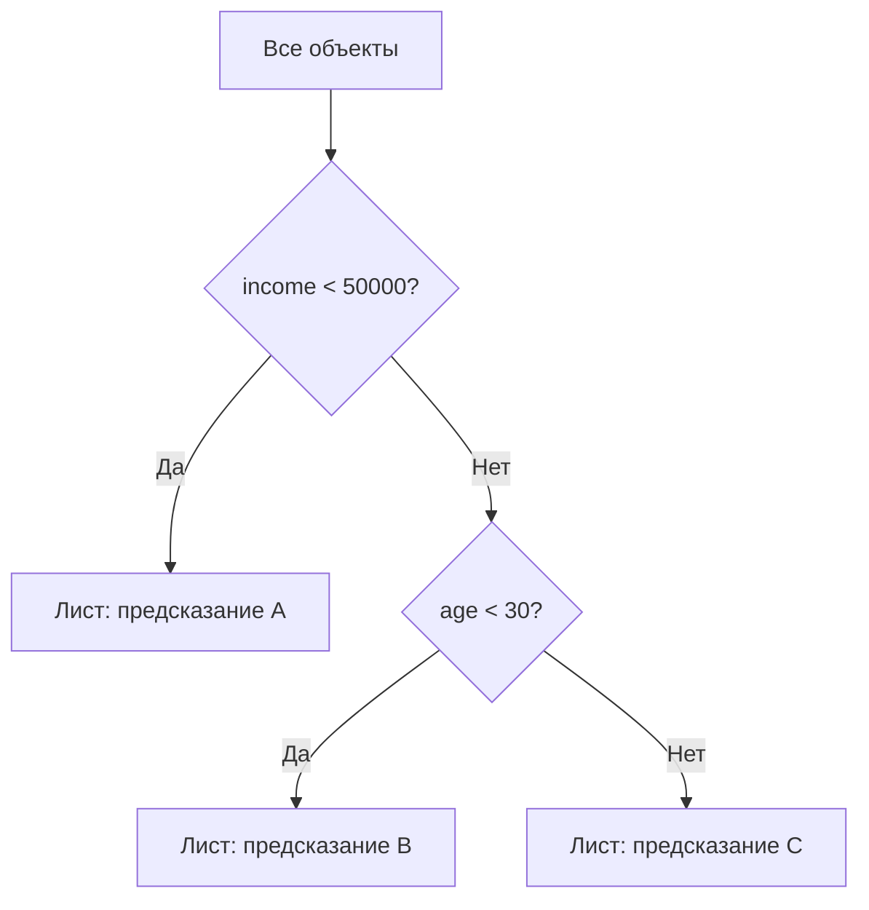

# Лекция 2. Табличный ML: деревья, ансамбли и градиентный бустинг

**Курс:** «Практикум по соревновательному машинному обучению от МТС»  
**Тип занятия:** лекция и практика  
**Дата:** 3 октября 2026  
**Основная идея:** строить модели на табличных данных, правильно оценивать их качество и понимать, как деревья и градиентный бустинг находят закономерности.

**Практика:** [ноутбук тренировки на Kaggle](https://www.kaggle.com/code/alexanderkireev/01-ml-trainings-tabs)

## 1. Задача и метрика

В соревновании **Microsoft Malware Prediction** требуется предсказать `HasDetections` — обнаружит ли система вредоносное ПО. Для каждого объекта модель выдаёт оценку или вероятность положительного класса. Для оценки используется **ROC-AUC**.

**ROC-AUC** — площадь под ROC-кривой. Метрика оценивает, насколько хорошо модель ставит положительные объекты выше отрицательных в ранжировании, рассматривая разные пороги классификации. Для её расчёта не требуется сначала превращать вероятности в классы `0` и `1`.

Если модель выдаёт логит \(z\), его можно преобразовать в вероятность сигмоидой:

$$
p=\sigma(z)=\frac{1}{1+e^{-z}}.
$$

После выбора порога, например `p >= 0.5`, можно получить метки и построить матрицу ошибок:

| | Предсказали 1 | Предсказали 0 |
|---|---:|---:|
| Истинный класс 1 | TP — верно найден | FN — пропущен |
| Истинный класс 0 | FP — ложная тревога | TN — верно найден отрицательный класс |

**Recall (полнота)** показывает, какую долю положительных объектов модель обнаружила при выбранном пороге:

$$
\mathrm{Recall}=\frac{TP}{TP+FN}.
$$

Итак, ROC-AUC оценивает ранжирование по всем порогам, а Recall — полноту при конкретном пороге.

## 2. Деревья решений 🌳

**Дерево решений** последовательно делит объекты условиями по признакам, например `income < 50000`. Внутренние узлы содержат условия, ветви — результаты условий, листья — итоговые предсказания.

При обучении дерево выбирает признак и условие разбиения, которые лучше разделяют объекты по целевой переменной. В классификации для оценки неоднородности часто используют **энтропию**:

$$
H(S)=-\sum_{c=1}^{C}p_c\log_2 p_c,
$$

где \(p_c\) — доля объектов класса \(c\), а \(C\) — количество классов. Энтропия равна нулю, если в узле только один класс; для двух классов она максимальна при равных долях.

**Information Gain (прирост информации)** — снижение энтропии после разбиения:

$$
IG=H(S)-\frac{n_L}{n}H(L)-\frac{n_R}{n}H(R),
$$

где \(L\) и \(R\) — дочерние узлы, \(n_L\) и \(n_R\) — количество объектов в них, \(n=n_L+n_R\). Для регрессии разбиения могут выбирать по снижению MSE или дисперсии.

Деревья находят **нелинейные зависимости** и взаимодействия признаков. Слишком глубокое дерево может переобучиться — запомнить особенности обучающей выборки. Сложность регулируют, например, `max_depth` (максимальная глубина) и `num_leaves` (максимальное число листьев; доступность и точное имя зависят от библиотеки).

## 3. Ансамбли: bagging и boosting

**Ансамбль** объединяет несколько моделей в одно предсказание.

| Подход | Как обучаются модели | Как объединяются | Основная идея |
|---|---|---|---|
| **Bagging** | Независимо на bootstrap-выборках — случайных выборках с возвращением | Усреднение или голосование | Снизить разброс предсказаний |
| **Random Forest** | Как bagging; при разбиении каждого дерева также рассматривается случайное подмножество признаков | Усреднение или голосование | Сделать деревья менее похожими |
| **Boosting** | Последовательно: новые модели улучшают уже построенный ансамбль | Сумма вкладов моделей | Постепенно уменьшать ошибку |

Для интуитивного понимания ошибки модели используют разложение на три составляющие:

$$
\text{ошибка}\approx\text{bias}^2+\text{variance}+\text{неснижаемый шум}.
$$

- **Bias (смещение):** ошибка из-за слишком простых предположений модели.
- **Variance (разброс):** чувствительность к конкретной обучающей выборке.
- **Неснижаемый шум:** неопределённость, которую не устранить одной лишь сменой модели.

Это полезная интуиция для квадратичной ошибки, а не универсальное точное равенство для любых задач и метрик.

## 4. Как работает градиентный бустинг

Градиентный бустинг последовательно добавляет деревья, каждое из которых корректирует предсказания уже построенного ансамбля. Упрощённо:

$$
F_m(x)=F_{m-1}(x)+\eta f_m(x),
$$

где \(F_m\) — ансамбль после шага \(m\), \(f_m\) — новое дерево, а \(\eta\) — **learning rate**, уменьшающий вклад дерева. При меньшем learning rate обычно требуется больше деревьев.

**Функция потерь (loss)** измеряет ошибку предсказания. **Градиент** — производная, показывающая направление роста loss; для её уменьшения движутся в противоположном направлении. **Гессиан** — матрица вторых производных, описывающая кривизну функции. Классический градиентный бустинг использует отрицательный градиент, а алгоритмы второго порядка, например XGBoost, также используют вторые производные.

### Пример для бинарной классификации

Пусть модель выдаёт логит \(z\), а вероятность положительного класса равна \(p=\sigma(z)\). Для бинарной кросс-энтропии производные по логиту одного объекта:

$$
g=\frac{\partial L}{\partial z}=p-y,\qquad h=\frac{\partial^2 L}{\partial z^2}=p(1-p),
$$

где \(y\in\{0,1\}\), \(g\) — градиент, \(h\) — вторая производная. Если начальный логит \(z=0\), то \(p=0.5\), а \(h=0.25\). Градиент равен `+0.5` для класса `0` и `-0.5` для класса `1`.

### Значение листа и оценка разбиения

В бустинге второго порядка для листа суммируют градиенты и вторые производные объектов:

$$
G=\sum_i g_i,\qquad H=\sum_i h_i.
$$

Упрощённое оптимальное значение листа с L2-регуляризацией:

$$
w^*=-\frac{G}{H+\lambda},
$$

где \(\lambda\) штрафует слишком большие значения листьев.

Для оценки разбиения в XGBoost используют **gain** — насколько оно улучшает целевую функцию с учётом регуляризации:

$$
\mathrm{Gain}=\frac12\left(\frac{G_L^2}{H_L+\lambda}+\frac{G_R^2}{H_R+\lambda}-\frac{G^2}{H+\lambda}\right)-\gamma,
$$

где \(G=G_L+G_R\), \(H=H_L+H_R\), а \(\gamma\) — штраф за добавление разбиения. Чем больше положительный gain, тем полезнее разделение по этому критерию. Это стандартная упрощённая формула XGBoost; детали отличаются между библиотеками.

Для ускорения обучения на больших таблицах алгоритмы вроде LightGBM могут объединять значения числового признака в **бины** и оценивать разбиения по накопленным статистикам градиентов и вторых производных.

## 5. Валидация без утечки данных

| Набор | Назначение |
|---|---|
| **Train** | Обучение параметров модели |
| **Validation** | Выбор модели, настройка гиперпараметров, контроль переобучения |
| **Test** | Финальная оценка на данных, не использованных при выборе решения |

**Кросс-валидация (cross-validation)** несколько раз делит данные на обучение и проверку, после чего результаты сравнивают между собой. Способ разбиения выбирают с учётом задачи: для временных данных случайное перемешивание может позволить модели обучаться на будущем и проверяться на прошлом.

**Утечка данных (data leakage)** возникает, когда обучение или настройка модели используют информацию, недоступную при реальном предсказании. Например, ошибка может возникнуть из-за неправильного разбиения или предобработки, которая использует сведения из validation/test.

В Kaggle локальная метрика на validation и результат лидерборда могут различаться: выборки не обязаны быть одинаковыми по распределению. Многократная настройка под один validation или публичный лидерборд тоже может привести к подгонке под эти данные.

## 6. Data drift и adversarial validation

**Data drift** — изменение распределения признаков между train и test либо между обучением и будущими данными. Из-за такого сдвига качество модели может снизиться.

**Adversarial validation** проверяет, насколько легко различить train и test:

1. Объединить признаки train и test, не используя исходную целевую переменную.
2. Создать вспомогательную метку `is_train`: `1` для строк train, `0` для строк test.
3. Обучить классификатор определять источник строки и оценить ROC-AUC на отложенной части.

- ROC-AUC около `0.5`: по доступным признакам выборки трудно различить.
- Высокий ROC-AUC, близкий к `1`: в выборках заметны различия; стоит изучить распределения и причины сдвига.

Это диагностический сигнал, а не автоматическое доказательство утечки. После проверки нужно изучить признаки и убедиться, что различия не вызваны ошибкой подготовки данных.

## 7. Feature engineering и важность признаков

**Feature engineering** — преобразование исходных данных и создание новых признаков, которые помогают модели.

| Приём | Пример | На что обратить внимание |
|---|---|---|
| **Агрегации (`groupby`)** | Сумма, среднее или число транзакций клиента | Среднее может скрыть порядок и редкие крупные значения |
| **Категориальные признаки** | Кодирование региона или типа операции | Способ кодирования зависит от модели и данных |
| **Объединение таблиц (`join`/`merge`)** | Добавить к клиенту статистики его транзакций | Проверять ключи и число строк: соединение «один ко многим» может размножить строки |
| **Последовательности** | История клиента как тензор \((N,L,D)\) | \(N\) — число объектов, \(L\) — длина последовательности, \(D\) — число признаков на шаг |

Агрегации удобны для табличных моделей, а представление в виде последовательности сохраняет порядок событий и может использоваться нейросетями и механизмами внимания.

### Важность признаков

В LightGBM распространены два типа важности:

- **`split`** — сколько раз признак использовался для разбиения;
- **`gain`** — суммарный прирост целевой функции от разбиений с этим признаком.

Важность не доказывает причинно-следственную связь и сама по себе не гарантирует полезность на новых данных. Проверяйте выводы с помощью кросс-валидации и экспериментов с удалением признаков.

**Permutation importance** оценивает признак так: перемешивает его значения и измеряет, насколько ухудшилась метрика. **Target permutation** — отдельный контрольный эксперимент, в котором перемешивают целевую переменную `y`; тогда настоящая связь между признаками и ответом разрушается, и модель обычно не должна показывать устойчиво высокое качество.

## 8. Практические направления

- **Adversarial validation:** сравнить train и test, найти признаки, по которым они различаются, и проверить влияние этих признаков через локальную кросс-валидацию.
- **Home Credit Default Risk:** изучить [соревнование Kaggle](https://www.kaggle.com/competitions/home-credit-default-risk), объединение таблиц, групповые агрегаты, кодирование категорий и валидацию.
- **DART в LightGBM:** изучить режим бустинга, при котором во время обучения на отдельных итерациях исключается часть уже построенных деревьев, чтобы уменьшить чрезмерную зависимость от отдельных деревьев.

## Главное

- Дерево делит пространство признаков на области; в классификации разбиения можно выбирать по энтропии и Information Gain.
- Bagging обучает модели независимо, а boosting — последовательно. Random Forest сочетает bagging деревьев со случайным выбором признаков.
- Градиентный бустинг использует производные функции потерь, чтобы добавлять полезные деревья; методы второго порядка учитывают также вторые производные.
- Validation и кросс-валидация помогают оценить обобщающую способность. Утечка и подгонка под лидерборд делают оценку ненадёжной.
- Adversarial validation ищет различия train/test, а feature engineering создаёт дополнительные признаки. Результаты нужно проверять на корректной схеме валидации.

## Вопросы для самопроверки

1. Чем ROC-AUC отличается от Recall?
2. Что измеряют энтропия и Information Gain?
3. В чём разница между bagging и boosting?
4. Как градиент и вторая производная помогают градиентному бустингу?
5. Что означают \(\lambda\) и \(\gamma\) в формуле gain?
6. Для чего нужны train, validation и test? Что такое утечка данных?
7. Как работает adversarial validation и о чём говорит высокий ROC-AUC?
8. Чем `split` отличается от `gain` в важности LightGBM?
9. Какие риски есть у `groupby` и `join`?
10. Чем permutation importance отличается от target permutation?

### Краткие ответы

1. ROC-AUC оценивает ранжирование по разным порогам; Recall — долю найденных положительных объектов при одном выбранном пороге.
2. Энтропия измеряет неоднородность классов; Information Gain — снижение энтропии после разбиения с учётом размеров дочерних узлов.
3. Bagging обучает модели независимо и объединяет предсказания; boosting добавляет модели последовательно, улучшая ансамбль.
4. Градиент задаёт направление изменения loss, а вторая производная описывает кривизну функции потерь. Они используются для оценки вкладов и разбиений.
5. \(\lambda\) — L2-регуляризация значений листьев; \(\gamma\) — штраф за добавление разбиения.
6. Train нужен для обучения, validation — для выбора и настройки, test — для финальной оценки. Утечка — использование информации, недоступной при реальном предсказании.
7. Классификатор пытается различить строки train и test. Высокий ROC-AUC указывает на различие выборок, которое нужно исследовать.
8. `split` считает использования признака, `gain` суммирует улучшение целевой функции от разбиений.
9. Агрегации могут терять детали, а ошибочный `join` — дублировать строки или вызывать утечку.
10. Permutation importance перемешивает один признак и измеряет ухудшение метрики; target permutation перемешивает целевую переменную как контрольный эксперимент.

## Источники

- [Ноутбук тренировки по табличному ML на Kaggle](https://www.kaggle.com/code/alexanderkireev/01-ml-trainings-tabs)
- [scikit-learn: ROC-AUC](https://scikit-learn.org/stable/modules/generated/sklearn.metrics.roc_auc_score.html)
- [LightGBM: параметры и режим DART](https://lightgbm.readthedocs.io/en/latest/Parameters.html)
- [XGBoost: от деревьев к бустингу](https://xgboost.org/concept/from-trees-to-boosting/)
- [Kaggle: Home Credit Default Risk](https://www.kaggle.com/competitions/home-credit-default-risk)

---

*Учебные заметки для личного обучения. Репозиторий не является официальным ресурсом МТС или Kaggle.*
