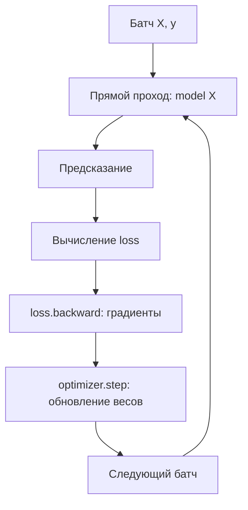

# Deep Learning: тензоры, слои нейросети и обучение

**Тип занятия:** лекция и практикум по Deep Learning  
**Дата:** 17 октября 2026  
**Основная идея:** понять, как данные проходят через нейросеть, как вычисляются градиенты и как оптимизаторы обновляют веса. Также посмотреть, как нейросети сочетают с моделями для табличных данных в соревнованиях Kaggle.  
**Ноутбук:** [02-ml-trainings-tabs — Kaggle](https://www.kaggle.com/code/alexanderkireev/02-ml-trainings-tabs)

## 🧠 1. Deep Learning и табличные данные

На соревнованиях по табличному ML часто сильны ансамбли деревьев — например, градиентный бустинг. Нейросети не заменяют их во всех задачах, но могут дополнять их: разные модели находят разные закономерности, а объединение предсказаний иногда повышает качество.

В этой тренировке рассматриваются:

- **Теория:** тензоры, линейные слои, функции активации, прямой и обратный проход, оптимизаторы.
- **Практика:** разбор решений Kaggle-задач и потоков данных через нейросеть.

### Библиотеки и инструменты

| Инструмент | Для чего нужен |
|---|---|
| **PyTorch** | Основная библиотека тренировки: тензоры, слои (`torch.nn`), оптимизаторы (`torch.optim`) и автоматическое дифференцирование |
| **TensorFlow / Keras** | Альтернативный стек для построения и обучения нейросетей; Keras предоставляет высокоуровневый интерфейс |
| **Hugging Face Transformers** | Предобученные модели и инструменты для работы с Transformer-архитектурами |
| **vLLM** | Эффективный запуск и обслуживание языковых моделей, в частности для высокопроизводительного инференса |
| **MONAI** | Инструменты на базе PyTorch для Deep Learning в медицинской визуализации |

### Логиты и вероятности

**Логит** — вещественное значение до преобразования в вероятность. Для бинарной классификации сигмоида переводит логит в диапазон от 0 до 1:

$$
\sigma(z)=\frac{1}{1+e^{-z}},\qquad z=\ln\frac{p}{1-p}.
$$

В градиентном бустинге для бинарной логистической функции потерь деревья часто добавляют поправки в пространстве логитов. Оптимальное значение в листе в приближении второго порядка имеет вид

$$
w^*=-\frac{G}{H+\lambda},
$$

где \(G=\sum_i g_i\) — сумма градиентов, \(H=\sum_i h_i\) — сумма гессианов, а \(\lambda\) — коэффициент L2-регуляризации. После суммирования поправок итоговый логит можно преобразовать в вероятность сигмоидой.

## 2. Тензоры и батчи

**Тензор** — многомерный массив чисел. В PyTorch тензорами представлены входные данные, параметры модели, градиенты и результаты вычислений.

| Объект | Форма | Значение |
|---|---|---|
| Один числовой признак для одного объекта | `()` или `(1,)` в зависимости от представления | Одно значение |
| Вектор признаков одного объекта | `(M,)` | `M` признаков |
| Батч объектов | `(B, M)` | `B` объектов, `M` признаков у каждого |
| Выход одного нейрона для батча | `(B, 1)` | Одно значение на объект |

Здесь \(N\) — число объектов во всей выборке, \(M\) — число признаков, \(B\) — размер батча. Например, при `B = 1024` вход модели имеет форму `(1024, M)`; последний батч эпохи может быть меньше.

### Эпоха, батч и перемешивание

- **Эпоха (epoch)** — один полный проход по обучающей выборке.
- **Батч (batch)** — часть выборки, на которой за один шаг вычисляются ошибка и градиенты.
- **Число шагов за эпоху** — примерно \(\lceil N/B\rceil\), если используется последний неполный батч.
- После каждого батча оптимизатор меняет веса, поэтому порядок объектов может влиять на траекторию обучения. При обучении данные обычно перемешивают (`shuffle=True`). При оценке и инференсе обычно отключают перемешивание, чтобы сохранить соответствие между объектами и предсказаниями.

В датасете PyTorch:

- `__len__()` возвращает число объектов;
- `__getitem__(i)` возвращает объект с индексом `i` (обычно признаки и целевое значение);
- `DataLoader` собирает объекты в батчи и может перемешивать их.

Для изображений к загрузке могут добавляться **аугментации** — случайные преобразования, увеличивающие разнообразие обучающих примеров. Например, **CutMix** вставляет участок одного изображения в другое и соответствующим образом смешивает метки.

## 3. Линейный слой и функции активации

Линейный слой `Linear(M, K)` принимает `M` признаков и выдаёт `K` значений для каждого объекта. У слоя есть обучаемые веса и смещения (`bias`).

$$
Y=XW^T+b.
$$

Если вход имеет форму `(B, M)`, то `Linear(M, 1)` выдаёт `(B, 1)`, а `Linear(M, 6)` — `(B, 6)`. Для одного объекта один выходной нейрон вычисляет

$$
y=b+\sum_{i=1}^{M}w_i x_i.
$$

Сам по себе линейный слой задаёт линейное преобразование. Чтобы сеть могла моделировать сложные нелинейные зависимости, между слоями используют функции активации.

| Функция | Формула | Назначение / свойство |
|---|---|---|
| ReLU | \(\max(0,x)\) | Обнуляет отрицательные значения; проста и часто используется в скрытых слоях |
| Leaky ReLU | \(\max(\alpha x,x)\), где \(0<\alpha<1\) | Сохраняет небольшой наклон для отрицательных значений |
| Sigmoid | \(\sigma(x)=1/(1+e^{-x})\) | Переводит число в диапазон `(0, 1)`; часто связана с вероятностью бинарного класса |
| Softmax | \(p_i=e^{z_i}/\sum_j e^{z_j}\) | Преобразует логиты нескольких классов в вероятности, сумма которых равна 1 |

Производная сигмоиды равна \(\sigma(x)(1-\sigma(x))\) и не превышает \(1/4\). При многократном перемножении малых производных градиенты в ранних слоях могут становиться очень маленькими — это одна из причин затруднённого обучения глубоких сетей.

Пример небольшой сети для бинарной классификации:

```text
Вход (B, M)
    ↓
Linear(M, 6)
    ↓
ReLU
    ↓
Dropout(0.2)
    ↓
Linear(6, 1)
    ↓
Логиты (B, 1) → Sigmoid → вероятности
```

При использовании `BCEWithLogitsLoss` в PyTorch на выходе оставляют **логиты** без сигмоиды: этот loss сам объединяет сигмоиду и бинарную кросс-энтропию численно устойчивым способом. Для многоклассовой `CrossEntropyLoss` также передают логиты, а не результат Softmax.

### Dropout, масштабирование и BatchNorm

| Метод | Где применяется | Что делает |
|---|---|---|
| Масштабирование (scaling) | Обычно в предобработке данных | Приводит числовые признаки к сопоставимым масштабам; порядок объектов сохраняется |
| Dropout | Внутри модели | Во время обучения случайно обнуляет часть активаций, уменьшая совместную адаптацию нейронов |
| BatchNorm | Внутри модели | Нормализует активации по статистикам батча и затем обучает масштаб и сдвиг |

У Dropout параметр `p` — вероятность обнуления, поэтому значение должно быть в диапазоне от 0 до 1. Например, `Dropout(0.2)` означает обнуление примерно 20% активаций при обучении. В режиме `eval()` Dropout выключается; BatchNorm использует накопленные статистики.

Формула BatchNorm для одного признака:

$$
\hat{x}=\frac{x-\mu_B}{\sqrt{\sigma_B^2+\varepsilon}},\qquad y=\gamma\hat{x}+\beta,
$$

где \(\mu_B\) и \(\sigma_B^2\) — среднее и дисперсия в батче, \(\varepsilon\) предотвращает деление на ноль, а \(\gamma\) и \(\beta\) — обучаемые масштаб и сдвиг.

## 4. Прямой проход, backpropagation и цикл обучения

- `__init__` в классе модели создаёт слои и другие компоненты.
- `forward(x)` описывает, как вход проходит через слои и превращается в выход.
- **Прямой проход (forward pass)** вычисляет предсказание.
- **Функция потерь (loss)** сравнивает предсказание с целевым значением.
- **Обратное распространение ошибки (backpropagation)** с помощью цепного правила вычисляет градиенты функции потерь по обучаемым параметрам.
- **Оптимизатор** использует градиенты, чтобы обновить параметры.



Обычный цикл обучения в PyTorch выглядит так:

```python
optimizer.zero_grad()
logits = model(x)
loss = criterion(logits, y)
loss.backward()
optimizer.step()
```

`zero_grad()` очищает градиенты от предыдущего шага, `backward()` вычисляет новые градиенты, `step()` изменяет параметры. Часто loss усредняется по объектам батча (`reduction="mean"`), поэтому градиенты соответствуют средней ошибке на батче.

Цепное правило связывает производные последовательных операций. Если \(L\) зависит от параметра \(w\) через промежуточное значение \(a\), то

$$
\frac{\partial L}{\partial w}=\frac{\partial L}{\partial a}\frac{\partial a}{\partial w}.
$$

## 5. Оптимизаторы

Оптимизатор уменьшает функцию потерь, постепенно меняя параметры модели. **Learning rate** (скорость обучения) задаёт размер шага обновления.

| Оптимизатор | Основная идея | Что помнить |
|---|---|---|
| SGD | \(\theta_{t+1}=\theta_t-\eta g_t\) | Шаг против градиента; простая базовая версия |
| SGD + Momentum | Использует сглаженное направление предыдущих градиентов | «Инерция» уменьшает колебания и накапливает направление движения |
| Nesterov | Оценивает градиент в точке предварительного шага (*look-ahead*) | Вариант momentum с более дальновидной оценкой градиента |
| RMSprop | Нормирует шаг с помощью скользящего среднего квадратов градиентов | Адаптирует шаг отдельно для параметров |
| Adam | Сочетает среднее градиентов и среднее их квадратов | Популярный универсальный начальный выбор |
| AdamW | Adam с отдельным применением weight decay | Разделяет регуляризацию весов и накопление моментов градиента |

Для SGD с momentum идея записывается схематично:

$$
v_t=\mu v_{t-1}+g_t,\qquad \theta_{t+1}=\theta_t-\eta v_t,
$$

где \(g_t\) — текущий градиент, \(v_t\) — накопленное направление, \(\mu\) — коэффициент momentum, \(\eta\) — learning rate. Реальные реализации могут включать дополнительные поправки.

**Градиент** — первая производная функции потерь по параметрам. **Гессиан** — матрица вторых производных; он описывает локальную кривизну функции. Гессиан используется в методах второго порядка и, например, в градиентном бустинге по деревьям, но обычным SGD не требуется.

## 6. Категориальные признаки и Embedding

Нейросети для табличных данных могут получать разные типы входов:

1. **Числовые признаки** — например, возраст или доход; часто полезно масштабирование.
2. **Категориальные признаки** — например, город или тип полиса; их можно кодировать one-hot или преобразовывать в индексы для embedding.
3. **Дополнительные агрегаты** — например, частота категории. Такие признаки нужно рассчитывать без утечки информации из валидации или теста.

**Embedding** — обучаемая матрица векторов для категорий. Категория заменяется целочисленным индексом, по которому извлекается её векторное представление.

Если у признака «город» \(C\) уникальных значений, а размер embedding равен \(D\), то таблица embedding имеет форму \((C,D)\). Здесь \(D\) — гиперпараметр, задающий размерность представления.

Косинусная близость двух векторов:

$$
\operatorname{cos}(u,v)=\frac{u\cdot v}{\|u\|\,\|v\|}.
$$

Она сравнивает направление векторов: значение, близкое к 1, указывает на близкие направления, 0 — на ортогональность, а −1 — на противоположные направления. Векторы embedding могут учиться отражать полезные для задачи связи между категориями.

## 7. Kaggle-примеры и ансамбли

### Binary Classification of Insurance Cross Selling

Задача бинарной классификации: предсказать вероятность целевого события `Response`. На практике важно проследить весь поток: числовые и категориальные признаки → тензор входов → слои модели → логиты или вероятности → loss.

### Porto Seguro’s Safe Driver Prediction

В победившем решении Майкла Ярера использовался ансамбль из **одной LightGBM и пяти нейросетей**. Нейросети обучались на представлениях числовых данных, полученных скрытым слоем Denoising Autoencoder, а LightGBM работала с исходными признаками; простое усреднение предсказаний оказалось эффективным.

**Denoising Autoencoder (DAE)** — автоэнкодер, который получает зашумлённые или искажённые данные и учится восстанавливать исходные. Его скрытый слой может давать полезное представление признаков для другой модели. Это пример обучения представлений без обычной целевой метки задачи (unsupervised / self-supervised representation learning).

Главный практический вывод: качество ансамбля зависит не только от качества каждой модели, но и от того, насколько различаются их ошибки. Сравнивать подходы нужно на корректной кросс-валидации, а не только по публичному leaderboard.

## Вопросы для самопроверки

1. Чем отличаются эпоха и батч?
2. Как меняется форма `(B, M)` после `Linear(M, 1)`?
3. Зачем в нейросети нужны функции активации?
4. Для чего используют Dropout и что происходит с ним в `eval()`?
5. В каком порядке выполняются прямой проход, вычисление loss, backpropagation и шаг оптимизатора?
6. Чем градиент отличается от гессиана?
7. Что такое embedding и какова форма матрицы для `C` категорий с размерностью `D`?
8. Зачем объединять LightGBM и нейросети в ансамбль?

### Ответы

1. Эпоха — один полный проход по обучающей выборке; батч — часть выборки для одного шага оптимизации.
2. В `(B, 1)`: один выход на каждый объект батча.
3. Они добавляют нелинейность, позволяя сети моделировать более сложные зависимости, чем одна линейная функция.
4. Dropout случайно обнуляет часть активаций при обучении; в `eval()` он отключён.
5. Прямой проход → loss → `backward()` → `optimizer.step()`; перед шагом обычно вызывают `zero_grad()`.
6. Градиент состоит из первых производных и показывает направление роста; гессиан содержит вторые производные и описывает кривизну.
7. Embedding — обучаемый вектор для категории; матрица имеет форму `(C, D)`.
8. Разные модели могут улавливать разные закономерности; если ошибки дополняют друг друга, ансамбль повышает качество.

## Материалы

- [Ноутбук тренировки на Kaggle](https://www.kaggle.com/code/alexanderkireev/02-ml-trainings-tabs)
- [PyTorch: слои нейросетей (`torch.nn`)](https://docs.pytorch.org/docs/stable/nn.html)
- [PyTorch: AdamW](https://docs.pytorch.org/docs/stable/generated/torch.optim.AdamW)
- [Hugging Face Transformers](https://huggingface.co/docs/transformers/en/pipeline_tutorial)
- [vLLM](https://docs.vllm.ai/en/stable/)
- [MONAI](https://monai.readthedocs.io/en/latest/)
- [Победившее решение Porto Seguro: representation learning](https://www.kaggle.com/competitions/porto-seguro-safe-driver-prediction/writeups/michael-jahrer-1st-place-with-representation-learn)
