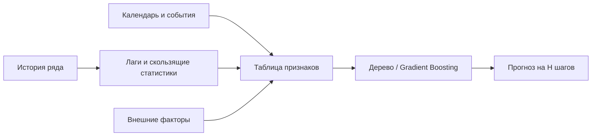
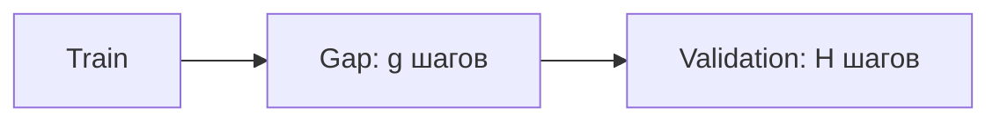
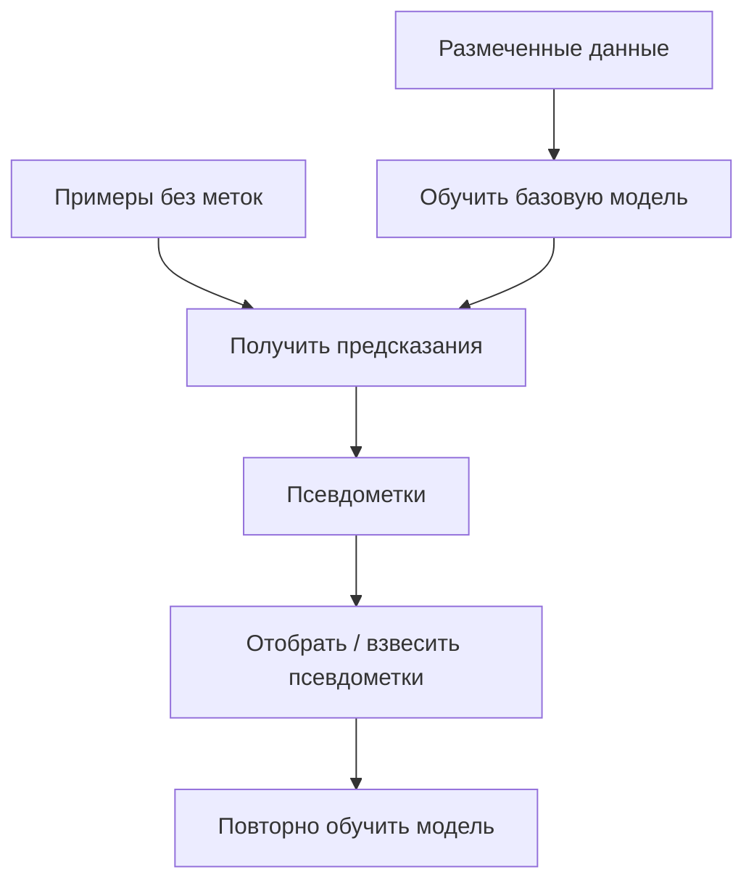
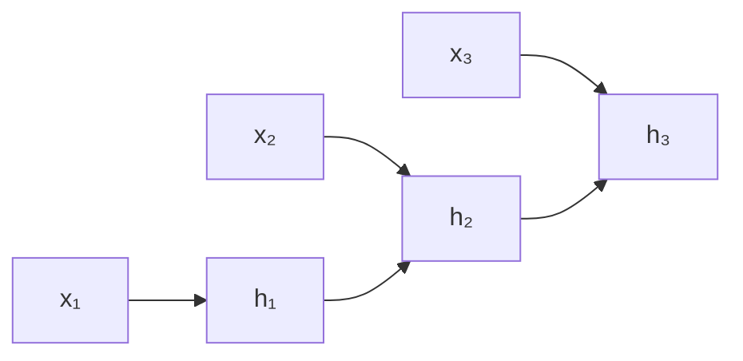
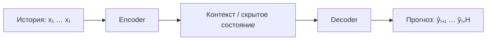

# Лекция 3. Временные ряды и прогнозирование

**Тип занятия:** лекция / тренировка по временным рядам  
**Дата:** 31 октября 2026  
**Основная идея:** научиться строить прогнозы на основе истории наблюдений, корректно валидировать временные модели и понимать базовые подходы — от лаговых признаков до Seq2Seq.

**Ноутбук занятия:** [03-ml-trainings-tabs](https://www.kaggle.com/code/alexanderkireev/03-ml-trainings-tabs)

## 1. Что такое временной ряд

**Временной ряд (time series)** — последовательность наблюдений, упорядоченных по времени:

\[
y_1, y_2, \ldots, y_t
\]

Задача прогнозирования — оценить будущие значения по доступной истории:

\[
\hat y_{t+1}, \hat y_{t+2}, \ldots, \hat y_{t+H},
\]

где \(H\) — горизонт прогнозирования (*forecast horizon*).

Примеры: продажи товаров по дням, спрос, выручка, температура, число пользователей.

### Основные компоненты ряда

| Компонент | Значение |
|---|---|
| Тренд (*trend*) | Долгосрочное направление изменения |
| Сезонность (*seasonality*) | Повторяющиеся закономерности с известным периодом: день недели, месяц, год |
| Цикл (*cycle*) | Долгосрочные колебания без строго фиксированного периода |
| Шум / остаток (*noise / residual*) | Нерегулярная часть, не объяснённая моделью |

Для аддитивной модели ряд представляют как:

\[
y_t = T_t + S_t + R_t,
\]

где \(T_t\) — тренд, \(S_t\) — сезонность, \(R_t\) — остаток.

**EDA (Exploratory Data Analysis)** помогает увидеть тренд, сезонность, выбросы и пропуски до обучения модели. Полезно строить графики ряда, агрегировать значения по дням недели и месяцам, сравнивать периоды.

## 2. Признаки для прогнозирования

### Лаговые признаки

**Лаг (lag)** — значение ряда в прошлом. Например:

\[
\text{lag}_1(t)=y_{t-1}, \qquad
\text{lag}_7(t)=y_{t-7}.
\]

Лаги позволяют модели учитывать недавние значения и повторение сезонных паттернов. Часто используют также скользящие статистики:

\[
\text{mean}_{7}(t)=\frac{1}{7}\sum_{k=1}^{7}y_{t-k}.
\]

Важно: при прогнозировании на дату \(t\) признаки должны использовать только информацию, доступную до \(t\). Поэтому скользящее среднее обычно сдвигают на один шаг (`shift(1)`), чтобы не включить текущее целевое значение.

### Календарные и сезонные признаки

Временную метку можно преобразовать в признаки:

- день недели, месяц, номер недели;
- выходной или праздничный день;
- расстояние до праздника;
- специальные события и периоды распродаж.

Дерево решений не «знает» о Новом годе само по себе. Ему нужно передать подходящие признаки, например `is_holiday`, `day_of_week` или `days_to_holiday`. Для циклических признаков (например, дня года) полезно кодирование через синус и косинус:

\[
x_{\sin}=\sin\left(\frac{2\pi t}{P}\right), \qquad
x_{\cos}=\cos\left(\frac{2\pi t}{P}\right),
\]

где \(P\) — период (например, 7 для недели или 365 для годового цикла).

### Важная особенность табличных моделей

Обычное дерево решений или градиентный бустинг можно применять к временным рядам, если превратить историю в таблицу признаков: лаги, календарные признаки, агрегаты и внешние факторы.

## 3. Валидация временных моделей

Обычное случайное разбиение `80/20` часто некорректно для временных рядов: в обучающую выборку могут попасть более поздние наблюдения, чем в валидационную. Это создаёт **утечку данных (data leakage)** и завышает качество.

Надёжный базовый вариант — хронологическое разбиение:

Для более устойчивой оценки применяют **time series cross-validation** (*rolling / expanding window validation*): несколько раз обучаются на прошлом и проверяются на следующем временном отрезке.

### Gap

**Gap** — промежуток между обучающей и валидационной частями, наблюдения из которого исключаются из обучения. Он полезен, когда соседние примеры или целевые интервалы пересекаются и это может привести к утечке.

Размер gap выбирают под конкретную задачу: учитывают горизонт прогноза, длину целевого окна и задержку появления данных. Это не универсальная константа и не всегда равно горизонту прогноза.

### Генерация обучающих примеров

Из длинного ряда можно построить множество обучающих окон (*sliding windows*):

| Историческое окно | Цель |
|---|---|
| \(y_1,\ldots,y_L\) | \(y_{L+1}\) |
| \(y_2,\ldots,y_{L+1}\) | \(y_{L+2}\) |
| \(\ldots\) | \(\ldots\) |

Случайно перемешивать такие окна при обучении иногда удобно, но валидация всё равно должна воспроизводить реальный сценарий: обучение на прошлом, прогноз на будущем. Следует исключать пересечение окон, которое даёт модели доступ к информации из валидационного периода.

## 4. Базовые методы и схемы обучения

### Last Value

Самый простой baseline — считать, что значение не изменится:

\[
\hat y_{t+h}=y_t,\qquad h=1,\ldots,H.
\]

Это **наивный прогноз (naive forecast)**, также называемый методом последнего значения (*last value*). Он полезен как точка отсчёта: сложная модель должна превосходить простой baseline на корректной валидации.

При выраженной сезонности можно использовать сезонный наивный прогноз:

\[
\hat y_{t+h}=y_{t+h-P},
\]

где \(P\) — период сезонности.

### Pseudo-labels

**Псевдоразметка (pseudo-labeling)** — использование предсказаний уже обученной модели в качестве дополнительных меток для новых, ещё не размеченных примеров.

В задачах временных рядов важно не подменять псевдометки реальными будущими наблюдениями и проверять, что схема не использует информацию из validation/test. Ошибки модели могут накапливаться, особенно при последовательном прогнозировании.

### Рекуррентная нейронная сеть

**RNN (Recurrent Neural Network)** обрабатывает последовательность по шагам и переносит информацию о предыдущих шагах в скрытое состояние:

\[
h_t=f(W_xx_t+W_hh_{t-1}+b).
\]

Здесь \(x_t\) — вход на шаге \(t\), \(h_t\) — скрытое состояние, \(W_x,W_h\) и \(b\) — обучаемые параметры, \(f\) — функция активации.

На практике используют, в частности, **LSTM** и **GRU** — разновидности рекуррентных сетей с механизмами управления потоком информации.

### Seq2Seq: Encoder–Decoder

**Seq2Seq (sequence-to-sequence)** — архитектура, преобразующая одну последовательность в другую. В прогнозировании временных рядов Encoder обрабатывает историю, а Decoder строит последовательность будущих значений.

- **Encoder** кодирует входную последовательность в представление, содержащее информацию об истории.
- **Decoder** использует это представление, чтобы сформировать прогноз на несколько шагов вперёд.
- При авторегрессионном декодировании следующий шаг зависит от предыдущего предсказания; ошибки могут накапливаться.

## 🏆 5. Kaggle-соревнования

### Corporación Favorita Grocery Sales Forecasting

**Задача:** прогнозировать ежедневные продажи товаров в магазинах сети.

Полезная идея — использовать прошлые значения целевой переменной как признаки: лаги, скользящие средние и сезонные лаги. Важны также календарь, праздники, акции и характеристики товаров и магазинов.

- `unit_sales` — количество проданных единиц; в данных встречаются отрицательные значения, связанные с возвратами.
- Официальная метрика — **NWRMSLE** (*Normalized Weighted Root Mean Squared Logarithmic Error*). Она сравнивает логарифмы факта и прогноза, учитывая веса товаров; отрицательные прогнозы недопустимы.

\[
\operatorname{NWRMSLE}=\sqrt{\frac{\sum_i w_i\left(\ln(1+\hat y_i)-\ln(1+y_i)\right)^2}{\sum_i w_i}},
\]

где \(w_i\) — вес наблюдения.

- Даже простой и аккуратно проверенный пайплайн с хорошими лаговыми признаками может быть сильным решением.

Материалы:
- [Соревнование](https://www.kaggle.com/competitions/favorita-grocery-sales-forecasting)
- [Стартовый LightGBM-ноутбук](https://www.kaggle.com/code/ceshine/lgbm-starter)
- [Публикация решения 1-го места](https://www.kaggle.com/competitions/favorita-grocery-sales-forecasting/discussion/47582)

### M5 Forecasting – Accuracy

**Задача:** спрогнозировать продажи товаров Walmart на 28 дней вперёд для множества товаров и магазинов.

Главная особенность — иерархическая структура данных и сложная метрика **WRMSSE** (*Weighted Root Mean Squared Scaled Error*).

Для одного временного ряда:

\[
\operatorname{RMSSE}_i =
\sqrt{
\frac{\frac{1}{H}\sum_{t=n+1}^{n+H}(y_{i,t}-\hat y_{i,t})^2}
{\frac{1}{n-1}\sum_{t=2}^{n}(y_{i,t}-y_{i,t-1})^2}}.
\]

WRMSSE — взвешенное среднее RMSSE по временным рядам и уровням агрегации. Поэтому качество оценивается не только на уровне отдельного товара и магазина, но и на более крупных группах.

**Калибровка прогноза:** иногда проверяют умножение всех прогнозов на коэффициент \(c\):

\[
\hat y' = c\hat y.
\]

Коэффициент выбирают по временной валидации. Это может исправить систематическое завышение или занижение, но подбор по leaderboard без надёжной локальной проверки легко приводит к переобучению на публичную выборку.

Материалы:
- [Соревнование и описание метрики](https://www.kaggle.com/competitions/m5-forecasting-accuracy/overview)
- [Обсуждение метрики и калибровки](https://www.kaggle.com/competitions/m5-forecasting-accuracy/discussion/166814)

### GoDaddy – Microbusiness Density Forecasting

**Задача:** предсказывать месячную плотность микробизнесов в округах США. Целевая переменная `microbusiness_density` — число микробизнесов на 100 жителей старше 18 лет.

- Простая отправная точка — **last value**: использовать последнее доступное значение для прогноза будущего.
- Метрика соревнования — **SMAPE** (*Symmetric Mean Absolute Percentage Error*): относительная симметричная ошибка между фактическими значениями и прогнозами.

\[
\operatorname{SMAPE}=\frac{200}{n}\sum_{i=1}^{n}\frac{|y_i-\hat y_i|}{|y_i|+|\hat y_i|},
\]

при \(y_i=\hat y_i=0\) вклад наблюдения принимают равным нулю.

- Для улучшения baseline можно учитывать тренд, прошлые изменения, характеристики округа и внешние социально-экономические признаки.

Материалы:
- [Соревнование](https://www.kaggle.com/competitions/godaddy-microbusiness-density-forecasting)
- [Last Value baseline](https://www.kaggle.com/code/cdeotte/new-last-value-baseline-1-4631)
- [Решение с рекуррентной GRU-моделью](https://www.kaggle.com/code/cdeotte/gru-model-3rd-place-gold)

## 6. Главное

1. Временной порядок наблюдений определяет корректную схему валидации: случайный `train/valid` split обычно не подходит.
2. Лаги, скользящие статистики, календарь и события превращают временной ряд в таблицу признаков для CatBoost / LightGBM и других моделей.
3. Всегда сравнивай сложную модель с простым baseline, например Last Value.
4. `Gap` снижает риск утечки между train и validation; его размер зависит от постановки задачи.
5. Pseudo-labeling и Seq2Seq могут помочь, но требуют проверки на временной валидации: ошибки и утечки способны ухудшить результат.

## Вопросы для самопроверки

1. Что такое временной ряд и горизонт прогнозирования?
2. Чем тренд отличается от сезонности?
3. Что такое лаговый признак? Почему нельзя использовать будущее значение при его расчёте?
4. Почему случайное разбиение train/validation может привести к утечке данных?
5. Для чего нужен `gap`?
6. Как работает метод Last Value?
7. В чём задача Encoder и Decoder в Seq2Seq?
8. Какие метрики использовались в трёх рассмотренных соревнованиях?

### Ответы

1. Временной ряд — упорядоченные по времени наблюдения; горизонт — число будущих шагов, для которых строится прогноз.
2. Тренд отражает долгосрочное направление изменения, сезонность — повторяющийся паттерн с определённым периодом.
3. Лаг — прошлое значение ряда, например \(y_{t-1}\). Будущее значение недоступно в момент прогноза и создаёт утечку.
4. В train могут оказаться данные из будущего относительно validation, из-за чего оценка перестаёт имитировать реальный прогноз.
5. Он исключает промежуточные наблюдения между train и validation, когда это необходимо для предотвращения утечки.
6. Предполагает, что будущее значение равно последнему известному: \(\hat y_{t+h}=y_t\).
7. Encoder кодирует историю; Decoder преобразует её представление в последовательность будущих прогнозов.
8. Favorita — NWRMSLE; M5 — WRMSSE; GoDaddy — SMAPE.

---

*Конспект подготовлен по материалам тренировки и открытым страницам Kaggle. Формулировки и дополнительные пояснения приведены для самостоятельного изучения.*
